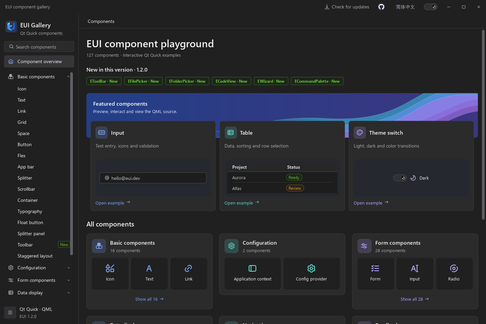
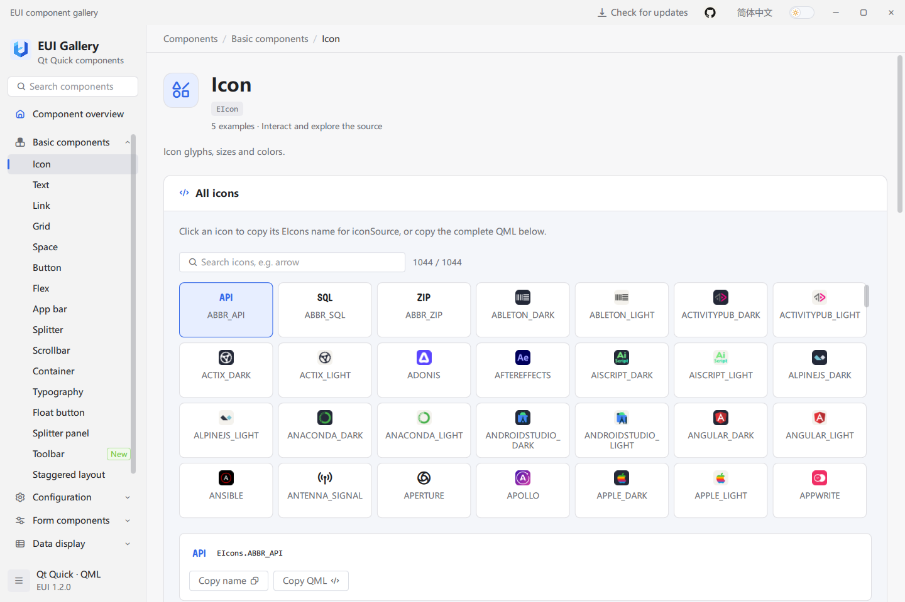
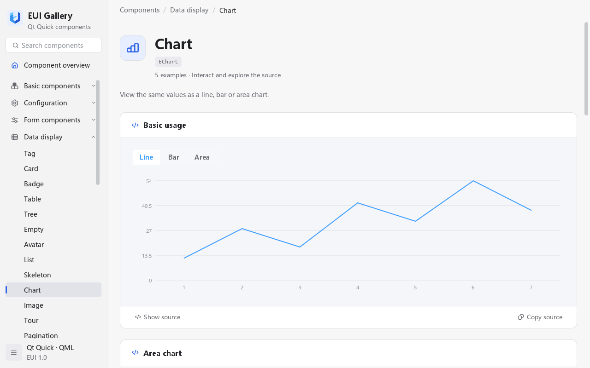

# EUI

用于 Qt Quick / QML 桌面应用的 UI 组件库。

简体中文 | [English](README.en.md)

> **使用问题反馈：`xiaojiaqaq@gmail.com`**
>
> 使用 EUI 时遇到问题，欢迎通过邮件联系。请附上 Qt 版本、操作系统、组件名称、复现步骤及错误信息；截图或最小示例有助于更快定位并解决问题。

## 从这里开始

| 你想做什么 | 阅读位置 | 完成后得到什么 |
| --- | --- | --- |
| 先体验组件 | 下方“运行组件示例” | 可以搜索、操作和复制源码的 Gallery |
| 在自己的应用中使用 EUI | [完整接入示例](docs/guide.zh-CN.md#3-接入自己的-qt-quick-应用) | 一个点击按钮后更新计数并显示消息的应用 |
| 使用某个控件 | [常用组件用法](docs/guide.zh-CN.md#4-常用功能是什么何时用如何用) | 表单、选择器、表格、树、上传、图表和布局的示例 |
| 将应用交给其他人运行 | [部署应用](docs/guide.zh-CN.md#6-部署应用) | 包含 EUI 模块和 Qt 运行库的程序目录 |


## 运行组件示例

### 1. 准备环境

使用 **Windows、Qt 5.15.2 MSVC 2019 64 位 Kit、CMake 3.20 或更高版本、Ninja**。打开 **Developer PowerShell for VS 2019**，使用 x64 编译环境。Qt 模块清单见[环境准备](docs/guide.zh-CN.md#1-环境准备)。

### 2. 构建 Gallery

将下面两条路径改为自己的仓库目录和 Qt Kit 目录，再在同一个 PowerShell 窗口执行：

```powershell
$euiRoot = 'D:/code/EUI'
$qtKit = 'D:/Qt/5.15.2/msvc2019_64'
$env:PATH = "$qtKit/bin;" + $env:PATH
Set-Location $euiRoot

cmake -S . -B build/local -G Ninja -DCMAKE_BUILD_TYPE=Release "-DCMAKE_PREFIX_PATH=$qtKit" -DEUI_BUILD_EXAMPLES=ON -DEUI_BUILD_TESTS=OFF
cmake --build build/local
```

成功后，程序位于 `$euiRoot/bin/Release/example.exe`，旁边的 `EUI/` 目录包含组件模块。Gallery 构建还会复制模块到 `$qtKit/qml/EUI/`，该目录需要可写。

### 3. 运行并操作组件

仍在仓库根目录执行：

```powershell
& ./bin/Release/example.exe
```

打开后按以下顺序操作：

1. 在左侧搜索 `EButton`，打开按钮页面。
2. 点击示例按钮，观察控件状态和交互效果。
3. 点击“显示源代码”，再点击“复制源码”。
4. 到页面下方查看属性、信号和方法。
5. 用右上角的语言按钮、主题开关切换中英文和明暗主题。

## 把组件用在自己的应用中

按照[完整接入示例](docs/guide.zh-CN.md#3-接入自己的-qt-quick-应用)依次完成：

1. 构建并安装 EUI，得到完整模块目录。
2. 创建 `MyEuiApp`，写入 `CMakeLists.txt`、`main.cpp`、`main.qml`、`resources.qrc`。
3. 构建应用，将完整 `EUI/` 目录复制到可执行文件旁。
4. 运行程序，点击“点击加一”，确认计数增加并显示消息。

指南在同一章节给出全部文件内容、构建和复制命令、完成后的目录结构。已存在 Qt Quick 项目时，见[接入已有项目](docs/guide.zh-CN.md#35-接入已有项目或替换示例组件)。

## 选择组件

| 需求 | 使用组件 | 先设置什么 |
| --- | --- | --- |
| 按钮、输入和选择 | `EButton`、`EInput`、`ESelect` | 显示文字、输入值、选项模型及事件处理器 |
| 表单校验 | `EForm`、`EFormItem` | `model`、`rules` 和字段 `prop` |
| 表格和树 | `ETable`、`ETree` | 行数据与列配置，或带唯一 `id` 的节点模型 |
| 列表 | `EList`、`EListy` | 数据数组、视口尺寸及稳定的条目 key |
| 消息和弹窗 | `EApp` | 内容放入容器，通过 `message`、`modal`、`notification` 操作 |
| 图表 | `EChart`、`EECharts` | 数值 `model` 或 ECharts `option`；后者需 WebEngine |
| 布局和装饰 | `EFlex`、`EFlexItem`、`EBorderBeam` | 间距、空间分配，或流光尺寸与动画时长 |
| 主题和语言 | `ETheme`、`ELocale`、`EConfigProvider` | `dark`、`language` 或局部配置 |

更多用法见[中文使用指南](docs/guide.zh-CN.md)；遇到加载或部署问题时，见[常见问题](docs/guide.zh-CN.md#7-常见问题)。

## 功能截图

### 可编辑表格

`ETable` 用于数据工作台。Gallery 中可体验编辑、校验、排序、多选、分页、列配置、导入导出及打印等功能；实际项目需配置列和业务数据。


### 表单与校验

`EForm` 组织数据与规则，`EFormItem` 将字段、标签及校验反馈关联起来。提交时可根据 `submitted(valid, model)` 的结果执行业务逻辑。


### 暗色主题

内置控件使用共享调色板；通过 `ETheme.dark` 或 `EThemeSwitch` 切换主题。下图为英文界面。



### 图标与原生图表

图标页支持搜索、复制枚举引用和 QML 片段。`EChart` 使用数值模型绘制简单折线、柱状及面积图；需要 ECharts 配置与交互能力时使用 `EECharts`。下图为英文界面。





上述图表截图使用 `EChart`；`EECharts` 需要 WebEngine 宿主初始化及支持的图形后端，详见[图表选择](docs/guide.zh-CN.md#45-图表选择)。
