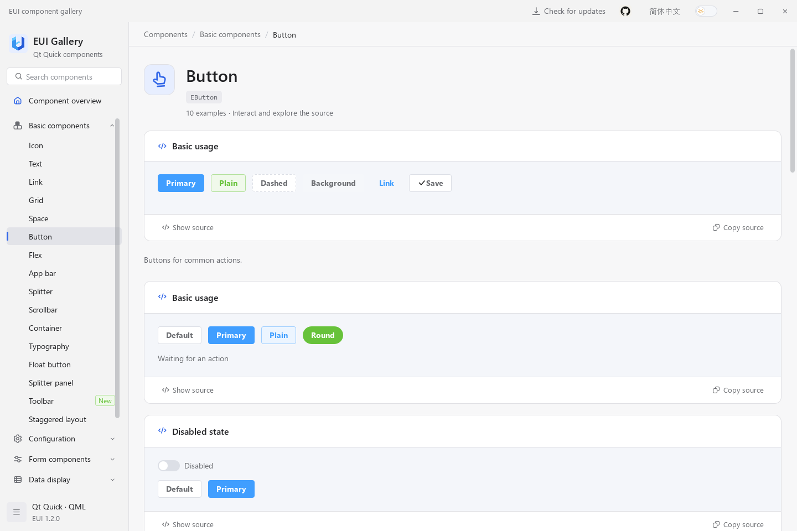
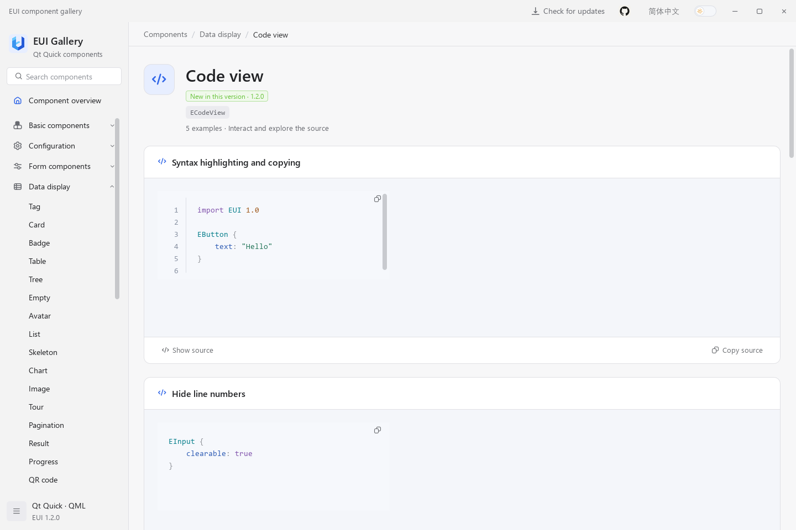
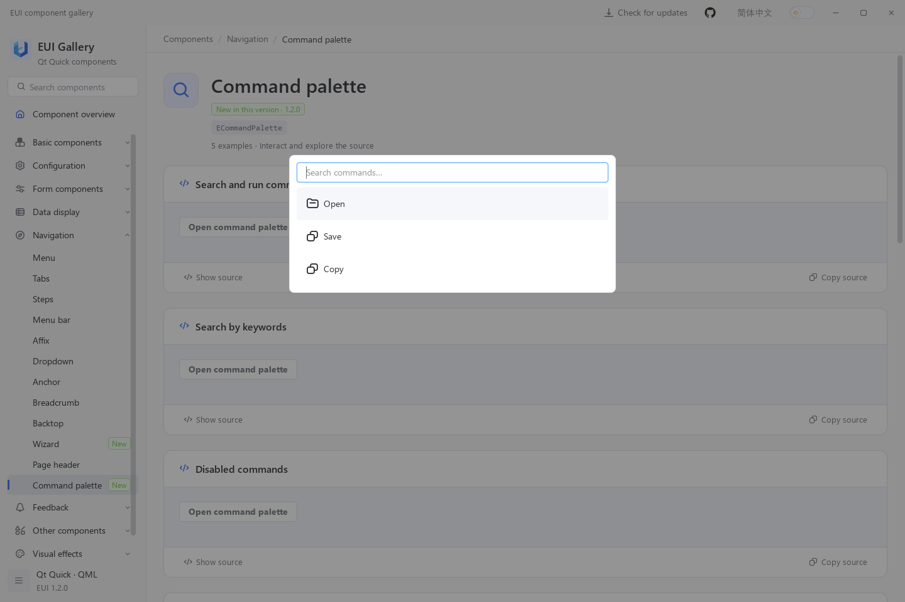
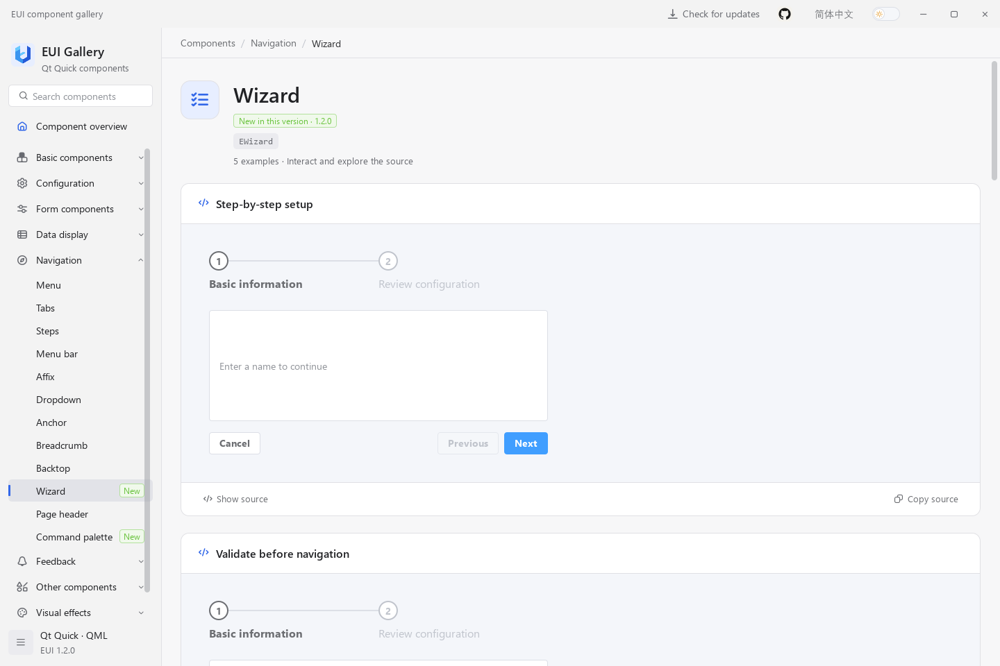

# EUI

English | [简体中文](docs/README.zh-CN.md)

EUI is a Qt Quick / QML component library for desktop applications, with forms, data tables, navigation, charts, and shared light and dark themes. The Gallery provides interactive examples, copyable QML source, and API references.

## Preview


## Try the Gallery

Download a package for your system and architecture from [GitHub Releases](https://github.com/lihechuan/EUI/releases). Use the installer, or extract the complete portable package and launch the Gallery. Keep its libraries and subdirectories together; packaged applications do not require a Qt SDK.

Search for a component, try its examples, and select **Show source** or **Copy source**. The API below each example explains its properties, methods, and signals. Use the language and theme controls to switch appearance.

## Build from source

The commands below run on Windows. Prepare a desktop Qt Kit, its matching C++ compiler, CMake, and Ninja using the [build guide](docs/guide.en.md#1-prerequisites). Open Developer PowerShell in the repository root and replace `$qtKit` with your Kit directory:

```powershell
$qtKit = 'D:/Qt/your-desktop-kit'
$env:PATH = "$qtKit/bin;" + $env:PATH

cmake -S . -B build/local -G Ninja -DCMAKE_BUILD_TYPE=Release `
    "-DCMAKE_PREFIX_PATH=$qtKit" -DEUI_BUILD_EXAMPLES=ON `
    -DEUI_BUILD_TESTS=OFF -DQML_PLUGIN_DUMP:FILEPATH=OFF
cmake --build build/local --target example --parallel
& ./bin/Release/example.exe
```

The build copies the EUI module beside the executable and into `$qtKit/qml/EUI/`; the Qt import directory must be writable. Other toolchain configurations are covered in the guide.

## Use in your application

1. Build and install EUI with the same Qt Kit and build configuration as your application.
2. Copy the complete `EUI/` module, including its plugin, into your application. Add its parent directory to the QML engine's import path.
3. Import the EUI module in your QML, then use the Gallery's examples and API to configure the controls you need.

The [application integration guide](docs/guide.en.md#3-integrate-a-qt-quick-application) includes a complete project, build commands, and QML examples. Follow the [deployment guide](docs/guide.en.md#6-deploy-your-application) when distributing your application.

## More components










## Support and license

Report problems or request features through [GitHub Issues](https://github.com/lihechuan/EUI/issues) or email [xiaojiaqaq@gmail.com](mailto:xiaojiaqaq@gmail.com). See [CONTRIBUTING.md](CONTRIBUTING.md) for contribution guidelines.

EUI uses the [MIT License](LICENSE). Third-party software and assets retain their own licenses; see [THIRD_PARTY_NOTICES.md](THIRD_PARTY_NOTICES.md).
