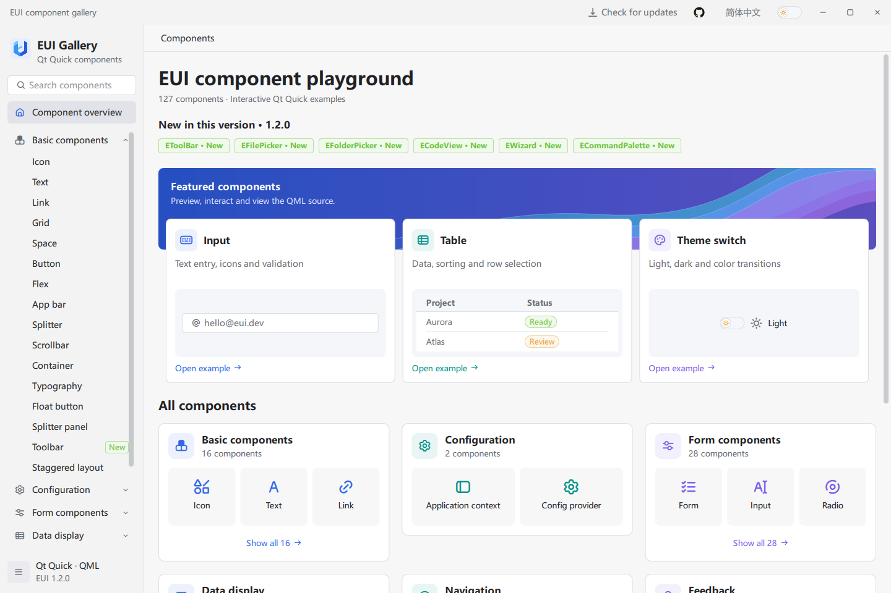
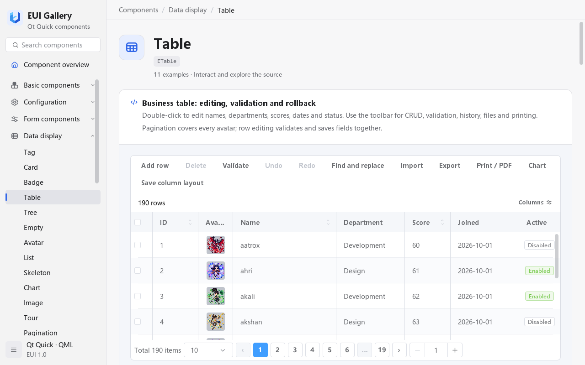
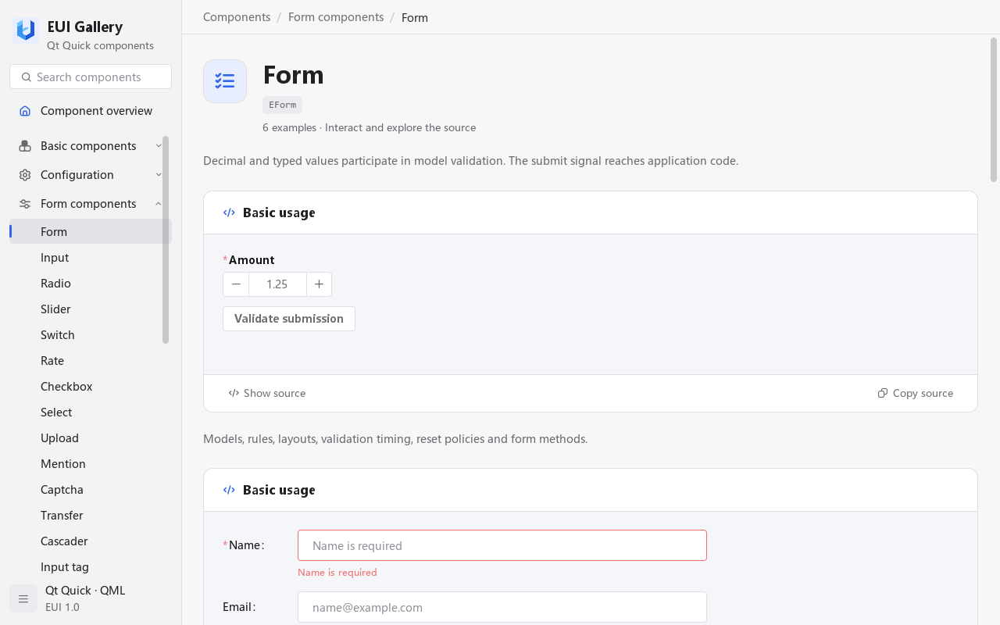

# EUI

A UI component library for Qt Quick / QML desktop applications. Explore **120 components** in an interactive Gallery with QML examples and API references.

English | [简体中文](README.zh-CN.md)

[](https://github.com/lihechuan/EUI/actions/workflows/build-windows.yml)
[](LICENSE)



## Features

- **Controls and layouts** — buttons, inputs, selectors, flex and grid layouts, menus, dialogs, and notifications.
- **Forms** — field validation, date and time pickers, and file uploads.
- **Data views** — editable tables with sorting, filtering, selection, import/export, and printing; trees and virtual lists.
- **Charts and animations** — native charts, Apache ECharts through WebEngine, and 83 animation presets.
- **Themes and language** — shared light and dark palettes, scoped configuration, and English and Chinese interfaces.

<details>
<summary>More screenshots: tables, forms, and dark theme</summary>

**Editable tables**



**Forms and validation**



**Dark theme**


See [all screenshots](docs/screenshots/README.md) for icons, charts, and source previews.

</details>

## Quick start

Once the EUI module is installed in your application's QML import path, use its controls with `import EUI 1.0`:

```qml
import EUI 1.0
import QtQuick 2.15

EButton {
    id: button

    text: "Animate"

    onClicked: EAnimation.play(button, "pulse", { duration: 500 })
}
```

Follow the [application integration guide](docs/guide.en.md#3-integrate-a-qt-quick-application) for a complete application, or build the Gallery below to explore the components first.

**Build the Gallery:** use Windows, Qt 5.15.2 MSVC 2019 x64, CMake 3.20+, and Ninja. From the repository root, run in an x64 **Developer PowerShell for VS 2019**, replacing `$qtKit` with your Qt path:

```powershell
$qtKit = 'D:/Qt/5.15.2/msvc2019_64'
$env:PATH = "$qtKit/bin;" + $env:PATH

cmake -S . -B build/local -G Ninja -DCMAKE_BUILD_TYPE=Release `
    "-DCMAKE_PREFIX_PATH=$qtKit" -DEUI_BUILD_EXAMPLES=ON -DEUI_BUILD_TESTS=OFF
cmake --build build/local --target example --parallel
& ./bin/Release/example.exe
```

See [prerequisites](docs/guide.en.md#1-prerequisites) for required Qt modules. The build copies EUI into `$qtKit/qml/EUI/`, which must be writable. In the Gallery, search for a component, try its examples, and select **Show source** or **Copy source**.

## Download and try

**v1.1.0 · Windows 10 / 11 x64**

[Installer](https://github.com/lihechuan/EUI/releases/download/v1.1.0/EUI-Gallery-1.1.0-windows-x64-setup.exe) · [Portable ZIP](https://github.com/lihechuan/EUI/releases/download/v1.1.0/EUI-Gallery-1.1.0-windows-x64-portable.zip) · [SHA-256 checksums](https://github.com/lihechuan/EUI/releases/download/v1.1.0/SHA256SUMS.txt) · [All releases](https://github.com/lihechuan/EUI/releases)

These packages contain the Gallery and its runtime; Qt and Visual Studio are not required. Use the installer, or extract the entire ZIP and run `EUI-Gallery.exe`, keeping all DLLs and subdirectories. The installer is unsigned. Verify downloads with `Get-FileHash FILE -Algorithm SHA256` against the checksum file.

Current build and release verification covers Windows x64 with Qt 5.15.2 MSVC 2019. Qt 6, Linux, macOS, ARM64, and MinGW have not undergone complete release verification.

## Documentation

- [Usage guide](docs/guide.en.md) — setup, application integration, and component examples.
- [Deployment and packaging](docs/guide.en.md#6-deploy-your-application) — distribute your application or build Gallery packages.
- [Troubleshooting](docs/guide.en.md#7-troubleshooting) — import paths, runtime dependencies, charts, and media.
- [Changelog](CHANGELOG.md) · [Contributing](CONTRIBUTING.md)

## Feedback

Report issues through [GitHub Issues](https://github.com/lihechuan/EUI/issues) or email [xiaojiaqaq@gmail.com](mailto:xiaojiaqaq@gmail.com). Include your Qt version, operating system, component name, reproduction steps, and error messages. A screenshot or minimal example helps diagnose the problem.

## License

EUI's own code and documentation are [MIT licensed](LICENSE). Third-party software and assets retain their own licenses; see [third-party notices](THIRD_PARTY_NOTICES.md).
