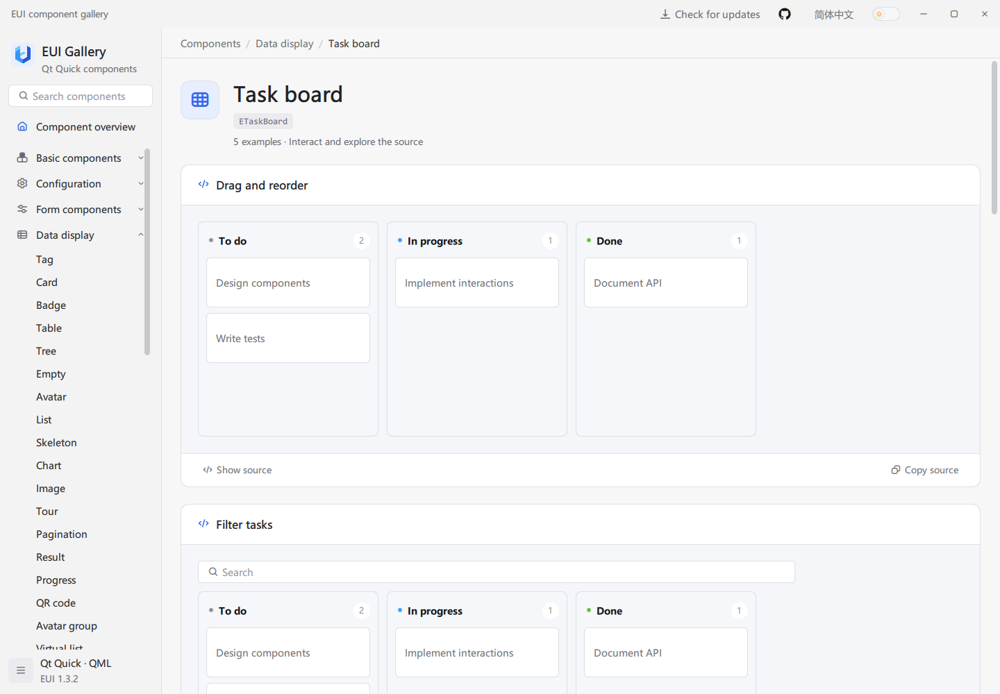
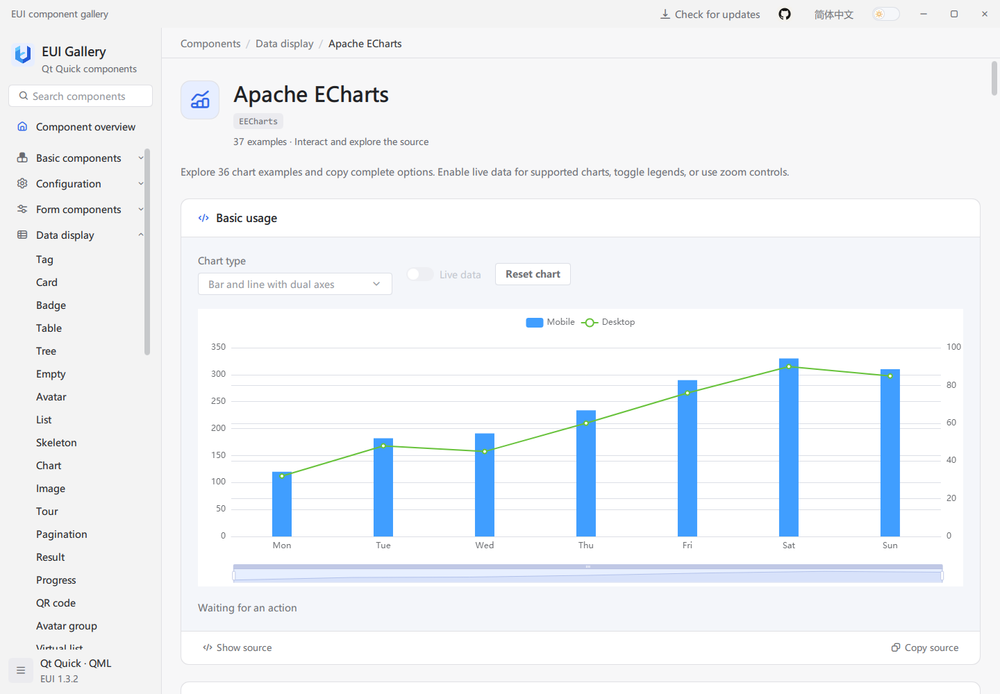
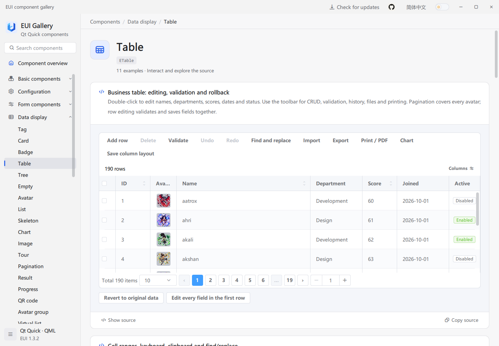
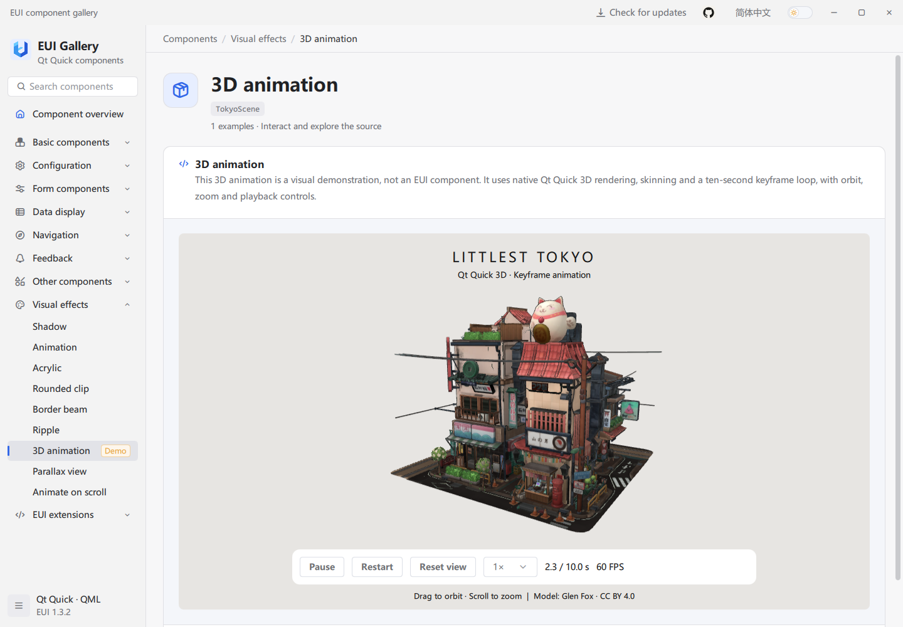

# EUI

English | [简体中文](docs/README.zh-CN.md)

EUI is a Qt Quick / QML component library for desktop applications, with forms, data tables, navigation, charts, image comparison, a scheduler, a task board, a rich text editor, and shared light and dark themes. The Gallery provides interactive examples, copyable QML source, and API references.

## Preview


Edit a table, switch between light and dark themes, and open the example's QML source. See [all screenshots](docs/screenshots/README.md) for more components.

## Try the Gallery

Download a package for your system and architecture from [GitHub Releases](https://github.com/lihechuan/EUI/releases). Use the installer, or extract the complete portable package and launch the Gallery. Keep its libraries and subdirectories together; packaged applications do not require a Qt SDK.

Direct downloads for [v1.3.2](https://github.com/lihechuan/EUI/releases/tag/v1.3.2):

| System | Architecture | Installer | Portable |
| --- | --- | --- | --- |
| Windows | x64 | [EXE](https://github.com/lihechuan/EUI/releases/download/v1.3.2/EUI-Gallery-1.3.2-windows-x64-setup.exe) | [ZIP](https://github.com/lihechuan/EUI/releases/download/v1.3.2/EUI-Gallery-1.3.2-windows-x64-portable.zip) |
| Windows | x86 (32-bit) | [EXE](https://github.com/lihechuan/EUI/releases/download/v1.3.2/EUI-Gallery-1.3.2-windows-x86-setup.exe) | [ZIP](https://github.com/lihechuan/EUI/releases/download/v1.3.2/EUI-Gallery-1.3.2-windows-x86-portable.zip) |
| macOS | Apple Silicon (arm64) | [DMG](https://github.com/lihechuan/EUI/releases/download/v1.3.2/EUI-Gallery-1.3.2-macos-arm64.dmg) | [ZIP](https://github.com/lihechuan/EUI/releases/download/v1.3.2/EUI-Gallery-1.3.2-macos-arm64-portable.zip) |
| macOS | Intel (x64) | [DMG](https://github.com/lihechuan/EUI/releases/download/v1.3.2/EUI-Gallery-1.3.2-macos-x64.dmg) | [ZIP](https://github.com/lihechuan/EUI/releases/download/v1.3.2/EUI-Gallery-1.3.2-macos-x64-portable.zip) |

Verify downloads against [SHA256SUMS.txt](https://github.com/lihechuan/EUI/releases/download/v1.3.2/SHA256SUMS.txt). This release does not include a Linux package.

Search for a component, try its examples, and select **Show source** or **Copy source**. The API below each example explains its properties, methods, and signals. Use the language and theme controls to switch appearance.

## Build from source

The commands below run on Windows. Prepare a desktop Qt Kit, its matching C++ compiler, CMake, and Ninja using the [build guide](docs/guide.en.md#1-prerequisites). Follow the [Qt 5.15.2 setup](docs/guide.en.md#1-prerequisites) or the [Qt 6.5+ build instructions](docs/guide.en.md#23-build-with-only-qt-6-installed) for the required modules. Open Developer PowerShell in the repository root and replace `$qtKit` with your Kit directory:

```powershell
$qtKit = 'D:/Qt/your-desktop-kit'
$env:PATH = "$qtKit/bin;" + $env:PATH

cmake -S . -B build/local -G Ninja -DCMAKE_BUILD_TYPE=Release `
    "-DCMAKE_PREFIX_PATH=$qtKit" -DEUI_BUILD_EXAMPLES=ON `
    -DEUI_BUILD_TESTS=OFF -DQML_PLUGIN_DUMP:FILEPATH=OFF
cmake --build build/local --target example --parallel
& ./bin/Release/example.exe
```

The build copies the EUI module beside the executable and into `$qtKit/qml/EUI/`; the Qt import directory must be writable. Other toolchain configurations are covered in the guide.

## Use in your application

1. Build and install EUI with the same Qt Kit and build configuration as your application.
2. Copy the complete `EUI/` module, including its plugin, into your application. Add its parent directory to the QML engine's import path.
3. Import the EUI module in your QML, then use the Gallery's examples and API to configure the controls you need.

With Qt 6, set the environment variable `QT_QUICK_CONTROLS_STYLE=Basic` before starting your application, as the Gallery does, to support customized controls.

Once the module is installed and its import path is configured, this `main.qml` opens a window with a click counter:

```qml
import EUI 1.0
import QtQuick 2.15

EApplicationWindow {
    id: window

    property int clicks: 0

    width: 420
    height: 240
    visible: true
    title: "EUI Demo"

    EButton {
        anchors.centerIn: parent
        styleType: EStyle.Primary
        text: "Clicks: " + window.clicks

        onClicked: window.clicks += 1
    }
}
```

The [application integration guide](docs/guide.en.md#3-integrate-a-qt-quick-application) includes the C++ entry point, CMake configuration, resource file, and deployment commands for a complete project.

## More components











The 3D scene is a visual demo with orbit, zoom, and playback controls. It is not an EUI component.


See [all screenshots](docs/screenshots/README.md) for more chart types, forms, source previews, and other components.

## Feedback

- Issues and feature requests: [GitHub Issues](https://github.com/lihechuan/EUI/issues)
- **Email: [xiaojiaqaq@gmail.com](mailto:xiaojiaqaq@gmail.com)**

See [CONTRIBUTING.md](CONTRIBUTING.md) for contribution guidelines.

## License

EUI uses the [MIT License](LICENSE). Third-party software and assets retain their own licenses; see [THIRD_PARTY_NOTICES.md](THIRD_PARTY_NOTICES.md).
