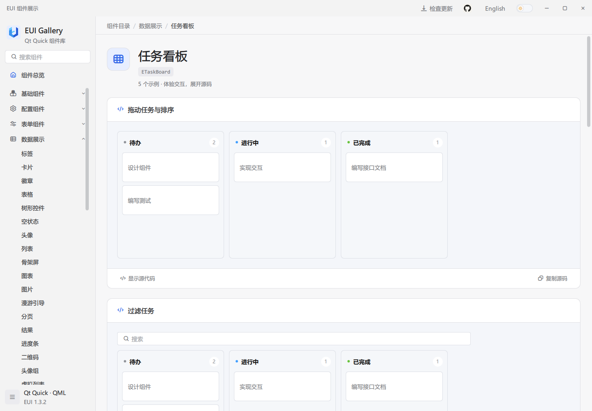
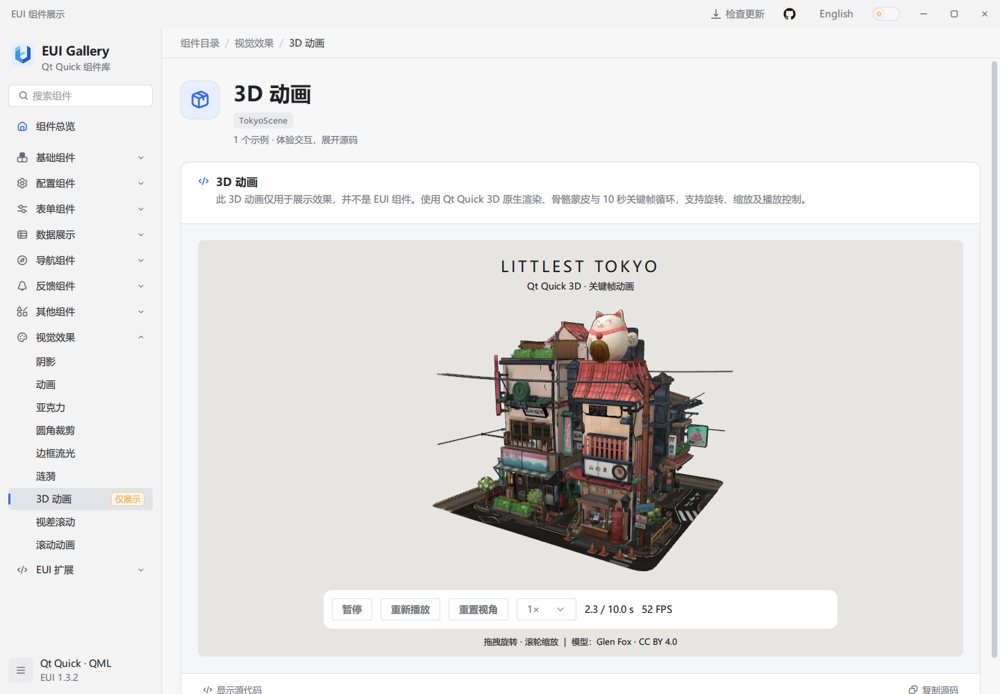
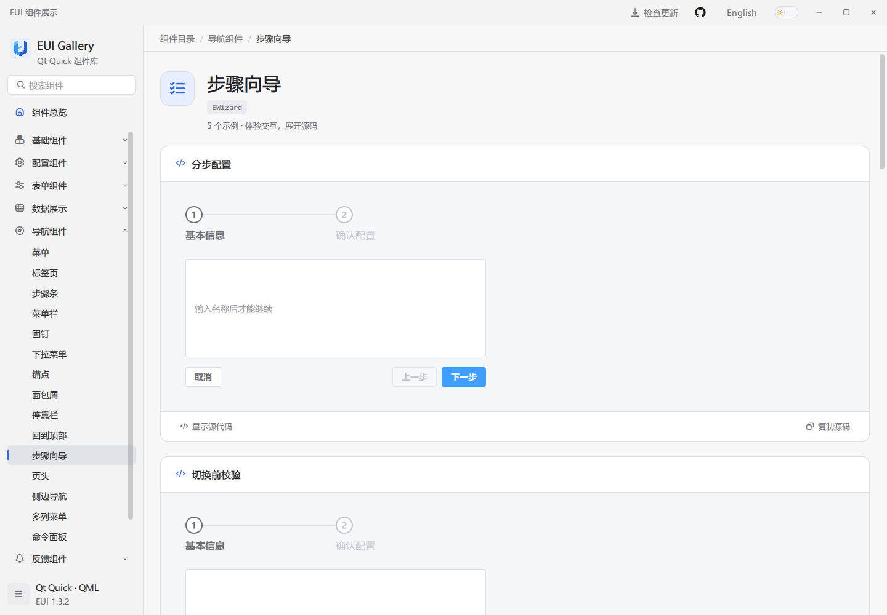

# EUI

[English](../README.md) | 简体中文

EUI 是面向 Qt Quick / QML 桌面应用的组件库，提供表单、数据表格、导航、图表、图片对比、事件排程、任务看板、富文本编辑和统一的明暗主题。Gallery 包含交互示例、可复制的 QML 源码和 API 参考。

## 界面预览


编辑表格、切换明暗主题，再展开示例的 QML 源码。更多组件见[全部截图](screenshots/README.md)。

## 体验 Gallery

从 [GitHub Releases](https://github.com/lihechuan/EUI/releases) 下载匹配系统和架构的安装包或免安装包。安装后启动 Gallery；免安装包需完整解压，保留其中的运行库和子目录。运行打包后的应用不需要安装 Qt SDK。

[v1.3.2](https://github.com/lihechuan/EUI/releases/tag/v1.3.2) 直接下载：

| 系统 | 架构 | 安装包 | 免安装包 |
| --- | --- | --- | --- |
| Windows | x64 | [EXE](https://github.com/lihechuan/EUI/releases/download/v1.3.2/EUI-Gallery-1.3.2-windows-x64-setup.exe) | [ZIP](https://github.com/lihechuan/EUI/releases/download/v1.3.2/EUI-Gallery-1.3.2-windows-x64-portable.zip) |
| Windows | x86（32 位） | [EXE](https://github.com/lihechuan/EUI/releases/download/v1.3.2/EUI-Gallery-1.3.2-windows-x86-setup.exe) | [ZIP](https://github.com/lihechuan/EUI/releases/download/v1.3.2/EUI-Gallery-1.3.2-windows-x86-portable.zip) |
| macOS | Apple Silicon（arm64） | [DMG](https://github.com/lihechuan/EUI/releases/download/v1.3.2/EUI-Gallery-1.3.2-macos-arm64.dmg) | [ZIP](https://github.com/lihechuan/EUI/releases/download/v1.3.2/EUI-Gallery-1.3.2-macos-arm64-portable.zip) |
| macOS | Intel（x64） | [DMG](https://github.com/lihechuan/EUI/releases/download/v1.3.2/EUI-Gallery-1.3.2-macos-x64.dmg) | [ZIP](https://github.com/lihechuan/EUI/releases/download/v1.3.2/EUI-Gallery-1.3.2-macos-x64-portable.zip) |

下载后可对照 [SHA256SUMS.txt](https://github.com/lihechuan/EUI/releases/download/v1.3.2/SHA256SUMS.txt) 校验文件。本版本未提供 Linux 安装包。

搜索组件并操作示例，点击“显示源代码”或“复制源码”。示例下方的 API 说明组件的属性、方法和信号，可通过语言和主题控件切换显示效果。

## 从源码运行

以下命令用于 Windows。按[构建指南](guide.zh-CN.md#1-环境准备)准备桌面 Qt Kit、匹配的 C++ 编译器、CMake 和 Ninja。所需模块分别见 [Qt 5.15.2 环境准备](guide.zh-CN.md#1-环境准备)和 [Qt 6.5+ 构建说明](guide.zh-CN.md#23-只安装-qt-6-时构建)。在仓库根目录打开 Developer PowerShell，将 `$qtKit` 改为自己的 Kit 路径：

```powershell
$qtKit = 'D:/Qt/your-desktop-kit'
$env:PATH = "$qtKit/bin;" + $env:PATH

cmake -S . -B build/local -G Ninja -DCMAKE_BUILD_TYPE=Release `
    "-DCMAKE_PREFIX_PATH=$qtKit" -DEUI_BUILD_EXAMPLES=ON `
    -DEUI_BUILD_TESTS=OFF -DQML_PLUGIN_DUMP:FILEPATH=OFF
cmake --build build/local --target example --parallel
& ./bin/Release/example.exe
```

构建会将 EUI 模块复制到可执行文件旁和 `$qtKit/qml/EUI/`，Qt 导入目录需要可写。其他工具链配置见构建指南。

## 接入自己的应用

1. 使用与应用相同的 Qt Kit 和构建配置编译、安装 EUI。
2. 将包含插件的完整 `EUI/` 模块复制到应用中，将它的父目录加入 QML 引擎的导入路径。
3. 在 QML 中导入 EUI 模块，参考 Gallery 的示例和 API 配置需要的组件。

使用 Qt 6 时，在启动应用前设置环境变量 `QT_QUICK_CONTROLS_STYLE=Basic`，与 Gallery 保持一致，以支持自定义控件样式。

安装模块并配置好导入路径后，将以下内容保存为 `main.qml`，即可在应用中显示一个点击计数窗口：

```qml
import EUI 1.0
import QtQuick 2.15

EApplicationWindow {
    id: window

    property int clicks: 0

    width: 420
    height: 240
    visible: true
    title: "EUI Demo"

    EButton {
        anchors.centerIn: parent
        styleType: EStyle.Primary
        text: "点击次数：" + window.clicks

        onClicked: window.clicks += 1
    }
}
```

[应用接入指南](guide.zh-CN.md#3-接入自己的-qt-quick-应用)提供配套的 C++ 入口、CMake 配置、资源文件和部署命令，可据此创建完整工程。

## 更多组件






三维场景是视觉演示，支持旋转、缩放与播放控制，并非 EUI 组件。




更多图表类型、表单、源码预览及其他组件见[全部截图](screenshots/README.md)。

## 问题反馈

- 问题与功能建议：[GitHub Issues](https://github.com/lihechuan/EUI/issues)
- **联系邮箱：[xiaojiaqaq@gmail.com](mailto:xiaojiaqaq@gmail.com)**

贡献规范见 [CONTRIBUTING.md](../CONTRIBUTING.md)。

## 许可证

EUI 采用 [MIT 许可证](../LICENSE)。第三方软件和资源保留各自许可，见 [THIRD_PARTY_NOTICES.md](../THIRD_PARTY_NOTICES.md)。
