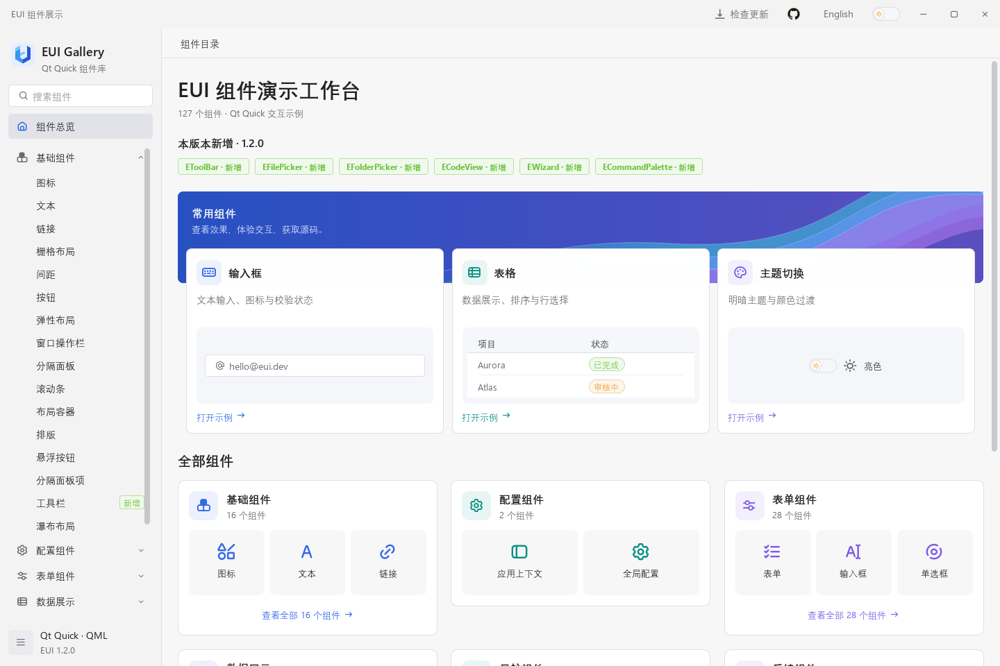
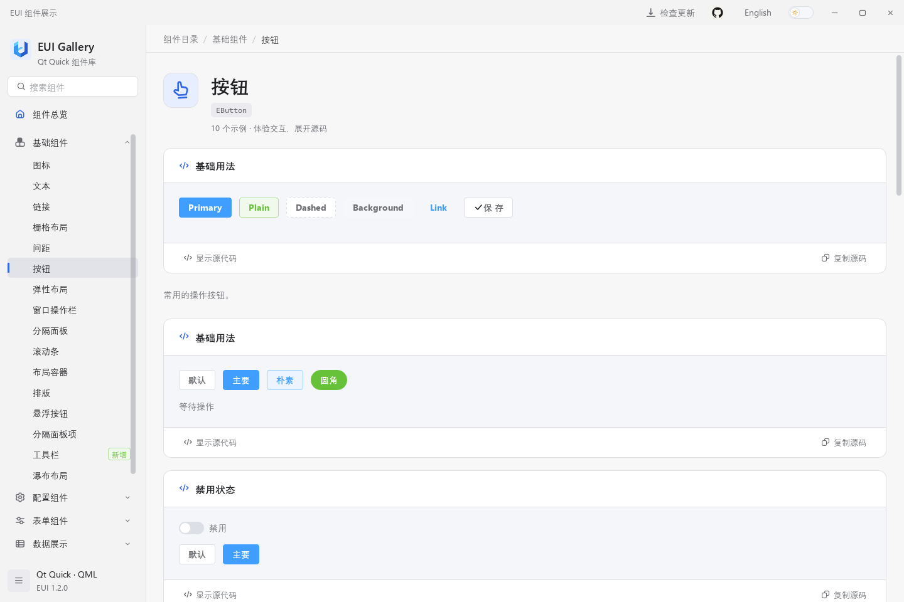
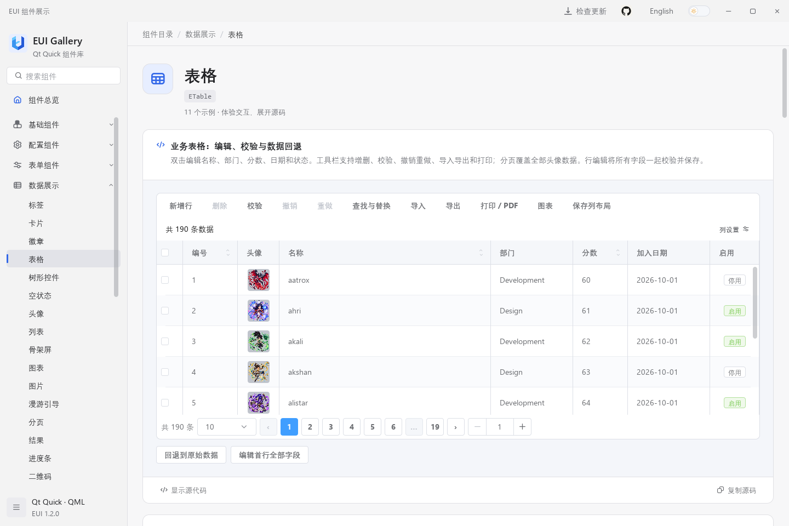
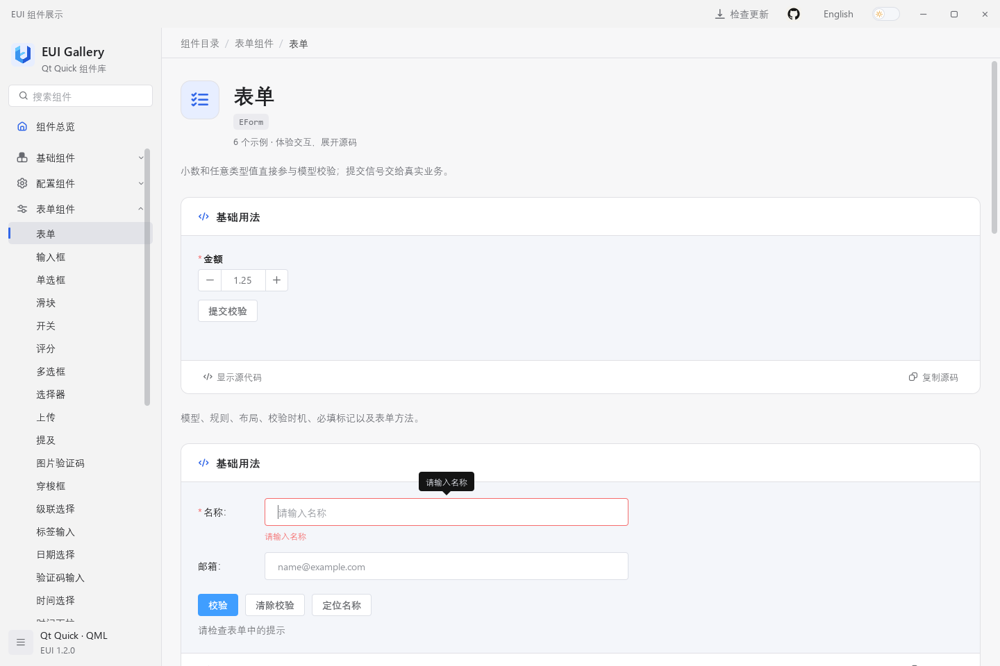
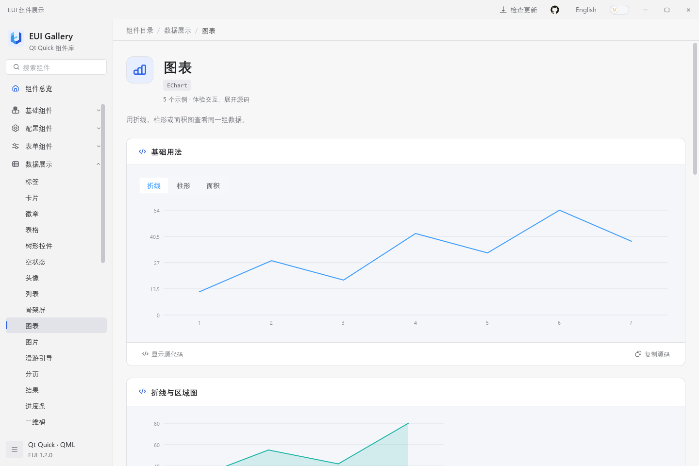
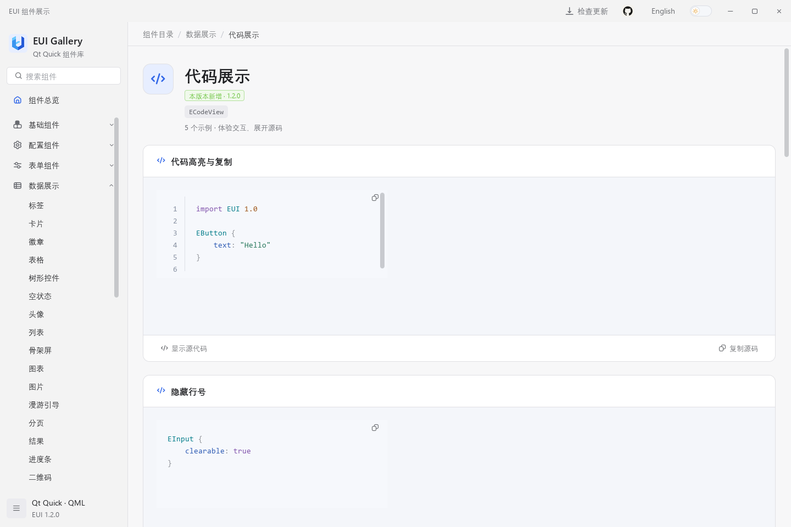
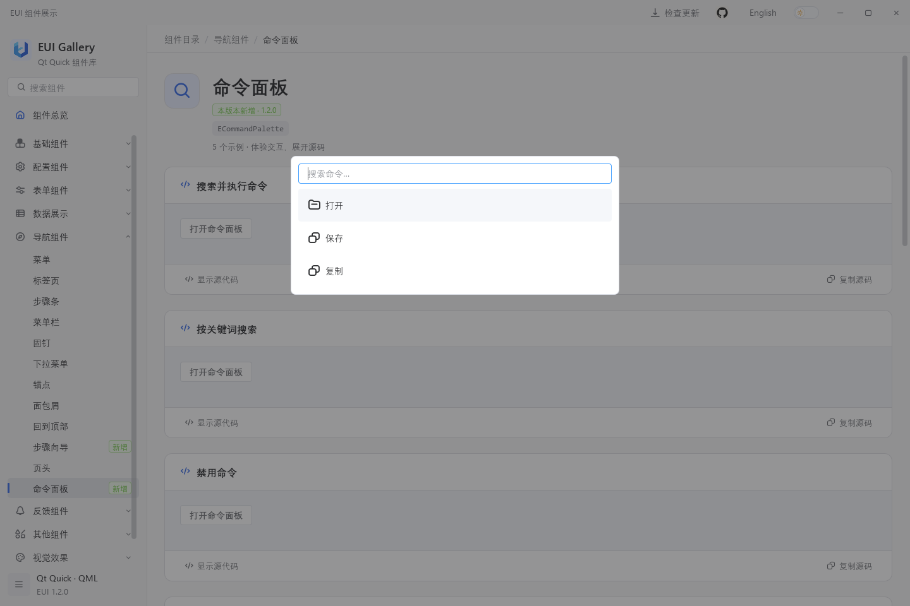
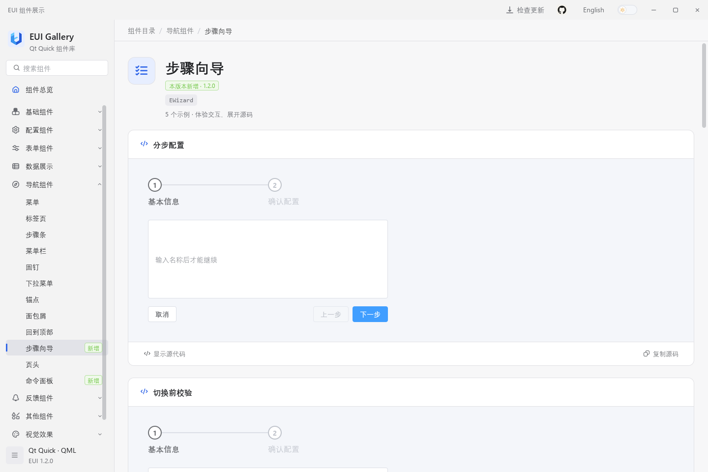

# EUI

[English](../README.md) | 简体中文

EUI 是面向 Qt Quick / QML 桌面应用的组件库，提供表单、数据表格、导航、图表和统一的明暗主题。Gallery 包含交互示例、可复制的 QML 源码和 API 参考。

## 界面预览



## 体验 Gallery

从 [GitHub Releases](https://github.com/lihechuan/EUI/releases) 下载匹配系统和架构的安装包或免安装包。安装后启动 Gallery；免安装包需完整解压，保留其中的运行库和子目录。运行打包后的应用不需要安装 Qt SDK。

搜索组件并操作示例，点击“显示源代码”或“复制源码”。示例下方的 API 说明组件的属性、方法和信号，可通过语言和主题控件切换显示效果。

## 从源码运行

以下命令用于 Windows。按[构建指南](guide.zh-CN.md#1-环境准备)准备桌面 Qt Kit、匹配的 C++ 编译器、CMake 和 Ninja，在仓库根目录打开 Developer PowerShell，将 `$qtKit` 改为自己的 Kit 路径：

```powershell
$qtKit = 'D:/Qt/your-desktop-kit'
$env:PATH = "$qtKit/bin;" + $env:PATH

cmake -S . -B build/local -G Ninja -DCMAKE_BUILD_TYPE=Release `
    "-DCMAKE_PREFIX_PATH=$qtKit" -DEUI_BUILD_EXAMPLES=ON `
    -DEUI_BUILD_TESTS=OFF -DQML_PLUGIN_DUMP:FILEPATH=OFF
cmake --build build/local --target example --parallel
& ./bin/Release/example.exe
```

构建会将 EUI 模块复制到可执行文件旁和 `$qtKit/qml/EUI/`，Qt 导入目录需要可写。其他工具链配置见构建指南。

## 接入自己的应用

1. 使用与应用相同的 Qt Kit 和构建配置编译、安装 EUI。
2. 将包含插件的完整 `EUI/` 模块复制到应用中，将它的父目录加入 QML 引擎的导入路径。
3. 在 QML 中导入 EUI 模块，参考 Gallery 的示例和 API 配置需要的组件。

[应用接入指南](guide.zh-CN.md#3-接入自己的-qt-quick-应用)提供完整工程、构建命令和 QML 示例。分发应用时，按[部署指南](guide.zh-CN.md#6-部署应用)准备运行库和模块文件。

## 更多组件















## 反馈与许可

通过 [GitHub Issues](https://github.com/lihechuan/EUI/issues) 提交问题或功能建议，也可以联系邮箱 [xiaojiaqaq@gmail.com](mailto:xiaojiaqaq@gmail.com)。贡献规范见 [CONTRIBUTING.md](../CONTRIBUTING.md)。

EUI 采用 [MIT 许可证](../LICENSE)。第三方软件和资源保留各自许可，见 [THIRD_PARTY_NOTICES.md](../THIRD_PARTY_NOTICES.md)。
