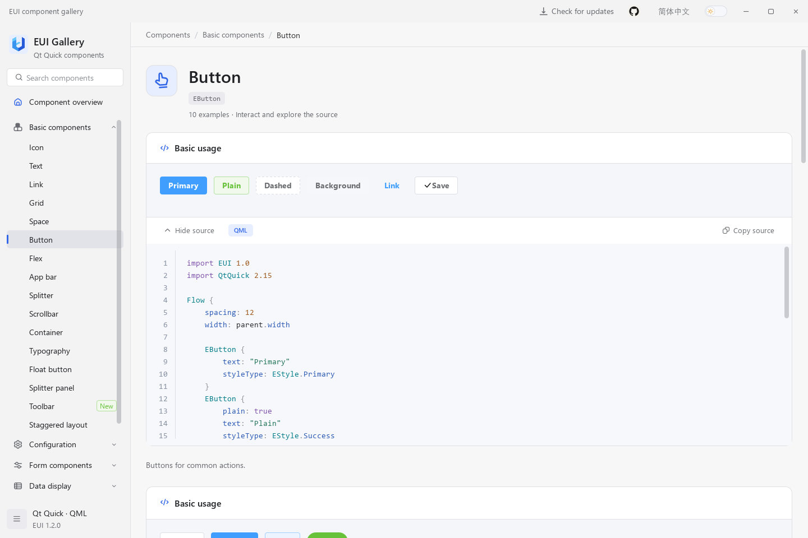

# EUI 使用指南

简体中文 | [English](guide.en.md) · [返回首页](README.zh-CN.md)

本指南的默认命令使用 **Windows、Qt 5.15.2 MSVC 2019 64 位 Kit、C++17 和 Ninja**。只安装 Qt 6 时，按[第 2.3 节](#23-只安装-qt-6-时构建)构建，再继续接入应用。第一次使用时，先选择一条流程：

| 目标 | 按顺序完成 | 完成标志 |
| --- | --- | --- |
| 体验现成组件 | 第 1 节 → 第 2.1 节 | Gallery 打开，能操作组件并查看源码 |
| 创建自己的应用 | 第 1 节 → 第 2.2 节 → 第 3 节 | 点击按钮后计数增加，并出现消息 |
| 接入已有 Qt Quick 项目 | 第 1 节 → 第 2.2 节 → 第 3.5 节 | 现有窗口中可以使用 `import EUI 1.0` |

项目介绍、界面截图和快速使用方法见[首页](README.zh-CN.md)。自行生成发布包见[第 6.3 节](#63-github-自动打包与下载)。

## 目录

- [1. 环境准备](#1-环境准备)
- [2. 构建 EUI](#2-构建-eui)
- [3. 接入自己的 Qt Quick 应用](#3-接入自己的-qt-quick-应用)
- [4. 常用功能：是什么、何时用、如何用](#4-常用功能是什么何时用如何用)
- [5. 使用 Gallery 学习组件](#5-使用-gallery-学习组件)
- [6. 部署应用](#6-部署应用)
- [7. 常见问题](#7-常见问题)

## 1. 环境准备

### 1.1 安装工具并打开终端

1. 安装 Visual Studio 2019 的 C++ 开发工具，使用 x64 编译环境。
2. 安装 Qt 5.15.2 的 `msvc2019_64` Kit，准备下表中的模块。
3. 安装 CMake 3.20 或更高版本及 Ninja，并将它们加入 PATH。
4. 打开 **Developer PowerShell for VS 2019**。后续命令都在这个窗口执行。

| 用途 | Qt 模块或文件 |
| --- | --- |
| 构建组件库 | Core、Gui、Qml、Quick、Widgets、Network、Concurrent、PrintSupport；匹配 Kit 的 `GuiPrivate`、`QmlPrivate` 私有开发头文件 |
| 构建 Gallery | 组件库依赖，以及 WebEngine、WebChannel |
| 本章最小应用 | QtQuick 2.15、QtQml 2.15、QtQuick.Window 2.15、QtQuick.Controls 2.15、QtGraphicalEffects 1.15 |
| 按需使用其他组件 | 日期面板需要 Qt.labs.calendar；文件对话框需要 QtQuick.Dialogs；媒体需要 QtMultimedia；`EECharts` 需要 QtWebEngine、QtWebChannel；SVG 图标需要 SVG 图片格式插件 |

在终端执行 `cmake --version`、`ninja --version`、`cl`，确认工具能够找到；`cl` 无参数显示版本和用法即可。

### 1.2 设置仓库和 Qt 路径

将两条路径改成你的实际目录：

```powershell
$euiRoot = 'D:/code/EUI'
$qtKit = 'D:/Qt/5.15.2/msvc2019_64'
$env:PATH = "$qtKit/bin;" + $env:PATH
Set-Location $euiRoot
```

`$euiRoot` 指向本仓库，目录里应有根 `CMakeLists.txt` 和 `source/`；`$qtKit` 指向包含 `bin/`、`lib/`、`qml/` 的 Qt Kit。后续命令沿用这两个变量，重新打开终端时先执行本节。

## 2. 构建 EUI

选择 2.1 或 2.2 执行即可。创建自己的应用时使用 2.2；它会生成可以复制到应用中的模块目录。

### 2.1 体验 Gallery

**执行位置：EUI 仓库根目录。**

```powershell
Set-Location $euiRoot
cmake -S . -B build/local -G Ninja -DCMAKE_BUILD_TYPE=Release "-DCMAKE_PREFIX_PATH=$qtKit" -DEUI_BUILD_EXAMPLES=ON -DEUI_BUILD_TESTS=OFF
cmake --build build/local
& ./bin/Release/example.exe
```

**完成标志：** Gallery 打开。搜索 `EButton`，操作按钮，点击“显示源代码”和“复制源码”；页面下方显示组件 API。

程序在 `$euiRoot/bin/Release/example.exe`，组件模块在旁边的 `EUI/`。构建还会将模块复制到 `$qtKit/qml/EUI/`，这个 SDK 目录需要可写。

Windows x64 的 Qt 5.15.2 Gallery 使用 QML 解释器和同步页面加载，规避该 Kit 的 JIT 异常表写入及嵌套异步创建崩溃；页面内的示例仍按可视区域延迟创建。解释器会增加 JavaScript 执行开销，本机回归中 127 个导航入口的首屏打开均小于 1 秒。Qt 6 Gallery 保持异步页面加载，组件库不会替宿主应用设置这两项兼容策略。

### 2.2 为自己的应用构建组件库

**执行位置：EUI 仓库根目录。**

```powershell
Set-Location $euiRoot
cmake -S . -B build/library -G Ninja -DCMAKE_BUILD_TYPE=Release "-DCMAKE_PREFIX_PATH=$qtKit" -DEUI_BUILD_EXAMPLES=OFF -DEUI_BUILD_TESTS=OFF
cmake --build build/library
cmake --install build/library --prefix build/eui-install
```

**完成标志：** `$euiRoot/build/eui-install/imports/EUI/` 中有 `qmldir`、`euiplugin.dll` 和其余模块文件。后续复制这个完整目录。以上使用 Release 配置，应用也使用同一 Qt Kit 和 Release 配置。

### 2.3 只安装 Qt 6 时构建

无需安装 Qt 5。`source/qt5` 是共享 QML 源码目录；CMake 使用 Python 将其适配到当前构建目录的 `source/qt6`，再使用 Qt 6 编译插件和 Gallery。源文件不会被转换脚本覆盖，`import EUI 1.0` 保持不变。

准备 Qt 6.5 或更高版本的桌面 Kit、匹配的 C++ 编译器、CMake、Ninja 和 Python 3。Qt 6.8.3 是本机验证版本。除了组件库基础模块，还需要 **Core5Compat、ShaderTools、Multimedia、SVG**；Gallery 需要 **WebEngineQuick、WebChannel**。Qt 6.8+ 安装 **Quick3D、QuickTimeline** 后可使用原生 3D 示例。文件选择使用 Qt Quick Dialogs，日历使用 Qt Quick Controls，遮罩使用 Qt5Compat.GraphicalEffects，Shader 在构建时生成 `.qsb`。

在对应编译器的 Developer PowerShell 中执行，将 `$qtKit` 改成自己的 Qt 6 Kit：

```powershell
$euiRoot = 'D:/code/EUI'
$qtKit = 'D:/Qt/6.8.3/msvc2022_64'
$env:PATH = "$qtKit/bin;" + $env:PATH
Set-Location $euiRoot

cmake -S . -B build/qt6 -G Ninja -DCMAKE_BUILD_TYPE=Release "-DCMAKE_PREFIX_PATH=$qtKit" "-DQT_DIR=$qtKit/lib/cmake/Qt6" "-DCMAKE_RUNTIME_OUTPUT_DIRECTORY=$euiRoot/build/qt6/bin" -DEUI_BUILD_EXAMPLES=ON -DEUI_BUILD_TESTS=OFF
cmake --build build/qt6
& ./build/qt6/bin/example.exe
```

只构建组件库时，将两个 `EUI_BUILD_*` 选项设为 `OFF`，再执行 `cmake --install build/qt6 --prefix build/eui-install-qt6`。接入第 3 节的应用时，使用相同的 `$qtKit`，并将复制来源改为 `build/eui-install-qt6/imports/EUI`。Qt 5 和 Qt 6 使用不同的构建、安装和程序目录，不混用两者的 `euiplugin.dll`。

运行 Qt 6 构建产物只需要匹配的 Qt 6 运行库；按第 6 节使用该 Kit 的 `windeployqt` 部署后，目标电脑无需安装 Qt SDK。Qt 5 编译的现有程序仍需要 Qt 5 运行库，不能直接使用 Qt 6 DLL 替代。

## 3. 接入自己的 Qt Quick 应用

本节从零创建 `MyEuiApp`。完成后，窗口显示“点击次数：0”；每次点击“点击加一”，数字增加并出现消息。

### 3.1 创建应用目录

先完成 2.2。下面路径是你的新应用目录，与 EUI 仓库是两个独立目录：

```powershell
$appRoot = 'D:/code/MyEuiApp'
New-Item -ItemType Directory -Force -Path $appRoot | Out-Null
Set-Location $appRoot
```

在 `$appRoot` 中创建四个 UTF-8 文本文件，目录结构为：

```text
MyEuiApp/
  CMakeLists.txt
  main.cpp
  main.qml
  resources.qrc
```

### 3.2 写入完整示例

将下面四个代码块分别保存到对应文件。文件名必须一致，`resources.qrc` 中的 `main.qml` 与实际文件名对应。

**`CMakeLists.txt`：定义程序和 Qt 依赖。**

```cmake
cmake_minimum_required(VERSION 3.20)
project(MyEuiApp LANGUAGES CXX)

set(CMAKE_CXX_STANDARD 17)
set(CMAKE_CXX_STANDARD_REQUIRED ON)
set(CMAKE_AUTOMOC ON)
set(CMAKE_AUTORCC ON)

find_package(QT NAMES Qt6 Qt5 REQUIRED COMPONENTS Quick Qml)
find_package(Qt${QT_VERSION_MAJOR} REQUIRED COMPONENTS Quick Qml)

add_executable(MyEuiApp main.cpp resources.qrc)
target_link_libraries(MyEuiApp PRIVATE Qt${QT_VERSION_MAJOR}::Quick Qt${QT_VERSION_MAJOR}::Qml)
```

**`main.cpp`：创建 QML 引擎，添加组件搜索目录，加载窗口。**

```cpp
#include <QUrl>
#include <QGuiApplication>
#include <QCoreApplication>
#include <QQmlApplicationEngine>

int main(int argc, char *argv[])
{
    QGuiApplication app(argc, argv);
    QQmlApplicationEngine engine;
    engine.addImportPath(QCoreApplication::applicationDirPath());
    engine.load(QUrl(QStringLiteral("qrc:/main.qml")));
    if (engine.rootObjects().isEmpty())
        return -1;
    return app.exec();
}
```

**`resources.qrc`：将 QML 窗口打包到程序中。**

```xml
<RCC>
    <qresource prefix="/">
        <file>main.qml</file>
    </qresource>
</RCC>
```

**`main.qml`：窗口、计数文字、按钮和消息交互。**

```qml
import EUI 1.0
import QtQuick 2.15

EApplicationWindow {
    id: window

    property int clickCount: 0

    width: 640
    height: 420
    visible: true
    title: "EUI Demo"

    Component.onCompleted: {
        ELocale.language = "zh"
        ETheme.dark = false
    }

    EApp {
        id: app

        anchors.fill: parent

        Column {
            x: 24
            y: 24
            spacing: 16

            EText {
                text: "点击次数：" + window.clickCount
            }
            EButton {
                text: "点击加一"
                styleType: EStyle.Primary

                onClicked: {
                    window.clickCount += 1
                    app.message.open("已点击 " + window.clickCount + " 次")
                }
            }
        }
    }
}
```

`EApplicationWindow` 是窗口；`EApp` 填满窗口并提供消息管理器；`EText.text` 绑定计数；`EButton.onClicked` 更新计数并调用 `app.message.open()`。该示例没有保存或网络请求。

### 3.3 构建应用并复制模块

**执行位置：新应用目录 `$appRoot`。** 继续使用第 1 节设置的 `$euiRoot` 和 `$qtKit`：

```powershell
Set-Location $appRoot
cmake -S . -B build -G Ninja -DCMAKE_BUILD_TYPE=Release "-DCMAKE_PREFIX_PATH=$qtKit"
cmake --build build
cmake -E copy_directory "$euiRoot/build/eui-install/imports/EUI" "$appRoot/build/EUI"
```

完成后的关键文件如下：

```text
MyEuiApp/
  CMakeLists.txt
  main.cpp
  main.qml
  resources.qrc
  build/
    MyEuiApp.exe
    EUI/
      qmldir
      euiplugin.dll
      plugins.qmltypes
      controls/
      ...其余模块文件
```

必须复制整个 `EUI/`，包括插件 DLL。`main.cpp` 添加的是可执行文件目录 `build/`，QML 引擎会从其下的 `EUI/` 找到 `import EUI 1.0`。应用的 CMake 只链接 Qt，EUI 插件通过 QML 导入加载。

### 3.4 运行并检查结果

**执行位置：新应用目录 `$appRoot`，保持同一终端中的 Qt PATH 设置。**

```powershell
& ./build/MyEuiApp.exe
```

1. 窗口标题为 `EUI Demo`，文字为“点击次数：0”。
2. 点击“点击加一”，文字变为“点击次数：1”，同时出现“已点击 1 次”消息。
3. 再点击一次，文字变为“点击次数：2”。

修改 `main.qml` 后先关闭程序，再执行 `cmake --build build` 并重新运行。QML 已打包进可执行文件，修改源文件需要重新构建。此时 Qt 运行库来自第 1 节的 PATH；交给其他电脑运行前，按第 6 节部署运行库。

### 3.5 接入已有项目或替换示例组件

已有 Qt Quick 项目可以继续使用原来的 C++ 入口、窗口和构建配置。构建 EUI 后，把完整模块复制到可执行文件旁，给现有 QML 引擎添加该父目录，在 QML 文件顶部写 `import EUI 1.0`，然后放入所需控件。使用消息管理器时，把界面内容放进 `EApp`。

第 4 节的代码块都是独立组件定义。要在本章示例中试用：

1. 保留 `EApplicationWindow`、`EApp` 和窗口初始化代码。
2. 用所选示例的根对象替换 `EApp` 内的整个 `Column { ... }`。
3. 将所需 imports 放在 `main.qml` 顶部，不放进对象内部。
4. 关闭程序，重新构建并运行。

例如，表格示例的 `ETable { ... }` 放入 `EApp` 后会显示两行数据；表单示例点击空内容的“提交”会显示必填校验。修改业务数据和信号处理器即可接入自己的逻辑。使用 `EECharts` 前，先按 4.5 配置 WebEngine 宿主。

## 4. 常用功能：是什么、何时用、如何用

以下代码块是组件定义，均列出所需 imports。按第 3.5 节将根对象放入窗口，imports 留在文件顶部。信号处理器中的业务逻辑由应用实现。

### 4.1 主题、语言与配置

**是什么：** `ETheme` 控制全局明暗主题，`ELocale` 提供中英文内置文本，`EConfigProvider` 为子控件提供默认尺寸和局部配置。

**何时用：** 为整套应用统一外观，或让某一区域使用紧凑尺寸、禁用状态及局部语言设置。

```qml
import EUI 1.0
import QtQuick 2.15

EConfigProvider {
    width: 320
    height: 120
    locale: "en"
    size: EStyle.Small

    EButton {
        text: "紧凑按钮"
        anchors.centerIn: parent
    }
}
```

在窗口初始化或语言切换事件中设置 `ELocale.language = "zh"` / `"en"`、`ETheme.dark = false` / `true`。`size` 支持 `EStyle.Small`、`Medium`、`Large`；控件显式设置的尺寸优先于默认值。Provider 的 `disabled: true` 会禁用其子控件。

语言切换更新内置标签、提示和 Gallery 文本。你直接写入的 `text`、`label` 和业务数据不会自动翻译，应使用应用自己的翻译或绑定。内置语言资源位于 [zh.json](../source/qt5/imports/eui/i18n/zh.json) 和 [en.json](../source/qt5/imports/eui/i18n/en.json)。

Provider 的 `locale: "en"` 或 `"zh"` 只设置该内容区域中支持配置继承的控件文本，不改变全局语言。也可传入 `locale: ({name: "zh", texts: {SelectAnOption: "选择项目"}})` 覆盖局部内置文案。

自定义控件颜色可使用 `EPaletteManager.ThemePalette.textRegular(ETheme.dark)`、`surfaceComponent(ETheme.dark)` 等调色板方法；状态色使用 `fetchColorForStyle(EStyle.Primary)`。

### 4.2 表单与选择器

**是什么：** `EForm` 管理模型与校验规则，`EFormItem` 关联模型字段及输入控件；`ESelect` 将显示文本与选项值分开。

**何时用：** 设置页、用户信息编辑、筛选条件或提交前必须检查数据的表单。

```qml
import EUI 1.0
import QtQuick 2.15

Column {
    width: 480
    spacing: 16

    EForm {
        id: form

        width: parent.width
        model: ({name: ""})
        rules: ({name: [{required: true, message: "请输入姓名"}]})

        onSubmitted: {
            if (valid)
                console.log("提交姓名", model.name)
        }

        EFormItem {
            label: "姓名"
            prop: "name"
            width: parent.width

            EInput {
                width: parent.width
                placeholderText: "请输入姓名"
            }
        }
    }
    EButton {
        text: "提交"

        onClicked: form.submit()
    }
}
```

`prop` 对应模型字段，`submit()` 触发校验及 `submitted(valid, model)`。通过 `validate(callback)` 仅执行校验，`resetFields()` 恢复初始字段值，`clearValidate()` 清除校验反馈。存在异步规则时，在回调或完成信号中读取最终校验结果。

```qml
import EUI 1.0
import QtQuick 2.15

ESelect {
    width: 240
    value: "list"
    clearable: true
    textRole: "label"
    valueRole: "value"
    placeholderText: "选择视图"
    model: [{label: "列表", value: "list"}, {label: "网格", value: "grid"}]

    onChanged: console.log(value)
}
```

`textRole` 是用户看到的名称，`valueRole` 是业务使用的值。通过 `value` 设置当前选项；`clear()` 清空选择。选项对象可通过 `disabled: true` 禁止选择。

日期选择使用 `EDatePicker.value`，格式为 `yyyy-MM-dd`；`minDate` / `maxDate` 限制范围，`disabledDate(date)` 接收 JavaScript `Date`。内嵌日期面板用 `EDatePickerPanel`。

### 4.3 表格、树与长列表

**是什么：** `ETable` 将行模型与列配置分开；`ETree` 展示父子节点；`EListy` 为长列表提供按需创建与复用的委托。

**何时用：** 数据台账、文件层级、导航树以及需要滚动浏览的大量条目。

```qml
import EUI 1.0
import QtQuick 2.15

ETable {
    width: 640
    height: 280
    model: [{name: "Alice", score: 92}, {name: "Bob", score: 88}]
    columns: [
        {prop: "name", label: "姓名"},
        {prop: "score", label: "分数", width: 120, sortable: true}
    ]

    onRowClicked: console.log(index, row.name)
}
```

`columns[].prop` 对应行对象字段，`label` 是列标题。设置固定的视口高度，行委托通过 `ListView` 创建。`sort("score", "ascending")` / `sort("score", "descending")` 排序，空排序字符串清除排序；列需配置 `sortable: true`。

`currentRowIndex` 和 `selectRow(index)` 使用原始模型索引，排序后仍保持该含义。`currentRow` 返回选择的行，`clearSelection()` 清除选择。替换整个 `model` 数组以通知 QML 数据更新。编辑、筛选、树行、工具栏和导出等配置见 Gallery 的 `ETable` 页面。

```qml
import EUI 1.0
import QtQuick 2.15

ETree {
    width: 320
    height: 240
    expandedKeys: ["root"]
    model: [{
        id: "root",
        label: "工作区",
        children: [{id: "docs", label: "文档"}]
    }]

    onNodeSelected: console.log(key, node.label)
}
```

给节点提供唯一字符串 `id` 作为稳定 key。通过 `select(key)` 选择节点，`setExpanded(key, expanded)` 设置展开状态；读取 `currentKey` / `currentNode` 获取选择。父节点禁用时，后代也会禁用。

列表组件按数据量和展示需求选择：

| 组件 | 用法 |
| --- | --- |
| `EList` / `EListItem` | 使用 JavaScript 数组展示标题、说明、头像及操作，支持分页和响应式网格；`grid` 可配置 `columns`、`gutter` 和 `itemHeight` |
| `EListy` | 将 JavaScript 数组赋给 `items`，设置视口宽高和 `rowKey`，默认按需创建、复用委托，适合长列表 |
| `EInfiniteScroll` | 需要直接使用 `QAbstractItemModel`、`ListModel` 或增量加载时使用 |

`EListy` 的条目可采用 `{id: 10, title: "Alpha", category: "A"}` 等对象，并设置 `rowKey: "id"`。用 `group: ({key: "category"})` 按字段分组；`group.key` 也接受 `(item) => key` 函数。更新列表时重新赋值 `items` 数组。

通过 `scrollTo(200)` 按像素滚动，或 `scrollTo({key: 10, align: "top", offset: 8})` 按稳定 key 定位；`align` 支持 `top/bottom/auto`。`scrollTo({groupKey: "A", align: "top"})` 定位到分组的首条数据。请求无效、key 重复或不存在时返回 `false`；分组回调失败时可读取 `errorString`。

自定义 `itemDelegate` 可以声明 `itemData`、`itemIndex`、`itemKey`、`groupKey` 和 `listControl` 属性，组件会更新这些字段。关闭 `virtual` 会缓存全部内容，适合少量数据。

### 4.4 文件上传与应用消息

**是什么：** `EUpload` 提供文件选择、队列及上传交互；`EApp` 为内容区域提供 `message`、`modal`、`notification` 管理器。

**何时用：** 选择附件、上传图片、提示保存结果或弹出业务确认。

```qml
import EUI 1.0
import QtQuick 2.15

EUpload {
    limit: 3
    width: 480
    maxFileSize: 5 * 1024 * 1024
    nameFilters: ["Images (*.png *.jpg)"]

    onSelected: console.log("已选择", files.length)
    onFailed: console.log(file.name, message)
    onSucceeded: console.log(file.name, response)
}
```

默认 `autoUpload: false`，上述示例仅选择本地文件。真正上传需要配置你的 HTTP(S) `action` 地址，再调用 `upload(index)` 或 `submit()`，也可以开启 `autoUpload`。请求默认使用 multipart，字段名是 `fieldName`（默认 `"file"`），可提供 `headers`。`maxFileSize` 单位为字节，`limit: 0` 表示不限制数量。`fileList` 提供文件及状态；`cancel()` 中止当前上传，`removeFile(index)` 移除条目。

用 `app.message.open("已保存")` 显示消息，第 3.2 节的完整窗口演示了按钮触发消息的用法。也可通过 `app.useApp()` 获取当前实例的管理器。`EApp` 是内容容器，需放入已有窗口；保存数据或调用服务的逻辑由应用实现。

### 4.5 图表选择

| 组件 | 是什么 | 适用情况 |
| --- | --- | --- |
| `EChart` | 使用 Qt 原生绘制的折线、柱状和面积图 | 简单数值序列、较低运行开销、软件渲染 |
| `EECharts` | 通过 Qt WebEngine 承载本地 Apache ECharts 分发文件 | ECharts option、多种图表、图例、缩放和事件交互 |

原生折线图：

```qml
import EUI 1.0
import QtQuick 2.15

EChart {
    width: 480
    height: 240
    type: EChart.Line
    model: [12, 18, 15, 26, 32, 28]
}
```

`EChart.type` 支持 `Line`、`Bar`、`Area`；`model` 可使用数值数组，也可使用 `{label, value}` 数据点数组，例如 `[{label: "周一", value: 12}, {label: "周二", value: 18}]`。`value` 是数值，`label` 用作横轴标签；省略标签时显示从 1 开始的序号。

`EECharts` 示例：

```qml
import EUI 1.0
import QtQuick 2.15

EECharts {
    width: 640
    height: 360
    renderer: "canvas"
    option: ({
        xAxis: {type: "category", data: ["Mon", "Tue", "Wed"]},
        yAxis: {type: "value"},
        series: [{type: "bar", data: [12, 20, 16]}]
    })

    onFailed: console.log(message)
}
```

该组件的 ECharts 脚本、HTML 和桥接资源在插件内本地打包，加载图表引擎不需要 CDN；远程数据或图片是否需要网络由你的 `option` 决定。`option` 必须能通过 JSON 传输，因此 JavaScript formatter 函数不能通过此桥接发送。读取 `ready` / `errorString`，使用 `setOption()`、`dispatchAction()` 等方法，并监听 `clicked`、`legendSelected`、`dataZoomed`。

使用 Qt 5 的 `EECharts` 时，将最小宿主的 `main.cpp` 增加头文件：

```cpp
#include <QtWebEngine/qtwebengineglobal.h>
```

在构造 `QGuiApplication` **之前**调用：

```cpp
QtWebEngine::initialize();
```

并在应用 CMake 中增加依赖：

```cmake
find_package(Qt5 5.15 REQUIRED COMPONENTS WebEngine WebChannel)
target_link_libraries(MyEuiApp PRIVATE Qt5::WebEngine Qt5::WebChannel)
```

Gallery 已实现宿主初始化，可参考 [example/src/main.cpp](../example/src/main.cpp)。`QT_QUICK_BACKEND=software` 下 `EECharts` 显示不可用说明，不创建 WebEngine 图表视图。启用该组件时应移除这项环境变量，并验证目标机器的图形后端。不要将 Qt Quick 软件场景图与 `QT_OPENGL=software` 混为同一设置。

### 4.6 布局、悬浮按钮与边框效果

**是什么：** `EFlex` 分配子项空间，`EFloatButton` / `EFloatButtonGroup` 提供悬浮操作入口，`EBorderBeam` 绘制沿边框运动的装饰流光。

**何时用：** 工具栏、可伸缩面板、固定位置的快捷操作，以及需要突出显示的卡片。

| 组件 | 关键配置 |
| --- | --- |
| `EFlex` | `gap` 设置间距，可使用数字或 `[horizontal, vertical]`；`justify` 支持 `start/center/end/space-between/space-around/space-evenly`，`align` 支持 `start/center/end/stretch` |
| `EFlexItem` | 包裹需要分配剩余空间的内容；`grow` / `shrink` 控制增长和收缩，`basis` 指定基础尺寸，`minSize` / `maxSize` 限制尺寸 |
| `EFloatButton` | 通过 anchors 或 x/y 放置；可设置图标、文字、徽标、提示和禁用状态 |
| `EFloatButtonGroup` | `trigger: "click"` 或 `"hover"` 展开菜单，空值表示常驻；`placement` 支持 `top/bottom/left/right` |
| `EBorderBeam` | 设置 `count`、`size`、`radius`、`duration`、`color` 等参数；`duration` 单位为秒，`running: false` 暂停，`reducedMotion: true` 停止并隐藏装饰 |

普通 `EFlex` 子项按现有尺寸排列，使用 `EFlexItem` 才启用增长和收缩。`basis: -1` 使用内容的隐式尺寸；自定义内容应提供 `implicitWidth/implicitHeight`，或显式设置 `basis`。不要同时给布局管理的子项设置位置 anchors。

悬浮按钮组的菜单可以超出组本身的边界，父项设置 `clip: true` 时会裁剪菜单。边框流光不捕获输入，内部内容仍可操作。完整交互与可复制的示例见 Gallery 中各组件页面。

### 4.7 一行调用动画

`EAnimation` 是 `import EUI 1.0` 提供的动画单例，不需要在页面中声明动画对象。

```qml
EAnimation.play(card, "fadeIn")
EAnimation.play(input, "shake")
EAnimation.play(card, "bounceIn")
EAnimation.play(card, "flipInY")
EAnimation.play(card, "slideInUp", { duration: 300, distance: 24 })
```

以上为独立的调用示例；`card`、`input` 是已有可视控件的 `id`。在事件中使用时，可写成 `onClicked: EAnimation.play(card, "fadeIn")`。

| 分类 | 完整效果名称 | 行为 |
| --- | --- | --- |
| 淡入淡出（18） | `fadeIn`、`fadeOut`、`fadeInUp`、`fadeInDown`、`fadeInLeft`、`fadeInRight`、`fadeOutUp`、`fadeOutDown`、`fadeOutLeft`、`fadeOutRight`、`fadeInTopLeft`、`fadeInTopRight`、`fadeInBottomLeft`、`fadeInBottomRight`、`fadeOutTopLeft`、`fadeOutTopRight`、`fadeOutBottomLeft`、`fadeOutBottomRight` | 带方向的效果同时移动；含上下左右和四个对角方向。 |
| 滑入滑出（8） | `slideInUp`、`slideInLeft`、`slideInDown`、`slideInRight`、`slideOutUp`、`slideOutDown`、`slideOutLeft`、`slideOutRight` | 上下左右滑动，同时淡入或淡出。 |
| 缩放（12） | `scaleIn`、`scaleOut`、`zoomIn`、`zoomOut`、`zoomInUp`、`zoomInDown`、`zoomInLeft`、`zoomInRight`、`zoomOutUp`、`zoomOutDown`、`zoomOutLeft`、`zoomOutRight` | scale 从 85% 缩放进入或退出；zoom 从 30% 缩放进入或退出，可组合方向位移。 |
| 旋转与滚动（13） | `rotateIn`、`rotateOut`、`rotateInUpLeft`、`rotateInUpRight`、`rotateInDownLeft`、`rotateInDownRight`、`rotateOutUpLeft`、`rotateOutUpRight`、`rotateOutDownLeft`、`rotateOutDownRight`、`spin`、`rollIn`、`rollOut` | rotate 绕中心或对应角旋转进入、退出；roll 组合位移与旋转；spin 旋转一周。 |
| 弹跳（11） | `bounce`、`bounceIn`、`bounceOut`、`bounceInUp`、`bounceInDown`、`bounceInLeft`、`bounceInRight`、`bounceOutUp`、`bounceOutDown`、`bounceOutLeft`、`bounceOutRight` | 弹跳强调，或带回弹的进入、退出；支持上下左右。 |
| 翻转（5） | `flip`、`flipInX`、`flipInY`、`flipOutX`、`flipOutY` | flip 绕 Y 轴翻转一周；X/Y 变体绕对应轴进入或退出。 |
| 强调与反馈（12） | `shake`、`pulse`、`shakeX`、`shakeY`、`swing`、`tada`、`wobble`、`jello`、`rubberBand`、`flash`、`heartBeat`、`headShake` | 横向或纵向抖动、脉冲、摇摆、欢呼、晃动、弹性扭曲、拉伸、闪烁和心跳；shake 是 shakeX 的兼容名称。 |
| 快速倾斜滑动（4） | `lightSpeedInLeft`、`lightSpeedInRight`、`lightSpeedOutLeft`、`lightSpeedOutRight` | 左右位移与倾斜，同时淡入或淡出。 |

`EAnimation.effects` 返回全部 83 个效果名称。第三个参数可省略，支持以下选项：

| 选项 | 默认值 | 取值 |
| --- | --- | --- |
| `duration` | `300` | 非负整数，单位毫秒；`0` 立即完成，最大值为 `2147483647` |
| `distance` | `24` | 位移或抖动距离，单位像素；范围 `0`～`1000000`，影响方向位移、弹跳和抖动 |
| `easing` | `Easing.OutCubic`；强调类和弹跳为 `Easing.Linear` | Qt 常规缓动枚举，例如 `Easing.InOutSine`；不支持需要额外控制点的曲线 |

`play()` 成功返回 `true`。空目标、未知效果、未知选项或非法数值返回 `false`，不会中断当前动画。同一控件再次调用会替换当前动画，不会叠加视觉变换；不同控件可以同时播放。

`EAnimation.stop(target)` 停止播放并清除动画位移、缩放、旋转、翻转和倾斜，恢复动画控制前的透明度；目标没有动画记录时返回 `false`。动画保留原有 anchors、位置、旋转、缩放及属性绑定。所有退出效果完成后透明度为 `0`；再次进入恢复原透明度，原本透明的控件进入至 `1`。强调效果结束后恢复原状态。

动画只控制视觉效果，不改变 `visible`、`enabled` 或布局占位；透明控件仍可能接收输入，应由业务逻辑管理交互状态。Gallery 的“视觉效果 → 动画”页面提供 8 个分类及全部效果的筛选预览、参数调整、一行调用代码和完整示例源码。

### 4.8 1.2.0 桌面应用组件

`import EUI 1.0` 保持不变，`1.2.0` 是组件库的软件版本。Gallery 导航显示绿色“新增”标签，详情显示引入版本，总览集中列出当前版本的新组件。标记来自组件目录的 `introducedIn` 字段，与构建版本匹配时显示，后续升级时旧组件不再标为当前版本新增。

| 组件 | 用途 | 关键接口 |
| --- | --- | --- |
| `EFilePicker` | 打开文件或选择保存位置 | `mode: "open" / "save"`、`multiple`、`nameFilters`、`folder`、`value`、`picked(value)` |
| `EFolderPicker` | 选择已有目录 | `folder`、`value`、`picked(value)`；预设 `mode: "folder"` |
| `EToolBar` | 统一操作栏，宽度不足时使用溢出菜单 | `model`、`showText`、`size`、`spacing`、`alignment`、`command(value, item)` |
| `ECodeView` | 只读源码展示与复制 | `code`、`language`、`highlight`、`showLineNumbers`、`showCopy`、`copy()` |
| `ECommandPalette` | 搜索和执行应用命令 | `model`、`shortcut`、`query`、`open()`、`closeOnTrigger`、`command(value, item)` |
| `EWizard` | 分步骤配置或导入流程 | `model`、`currentIndex`、`beforeLeave`、`next()`、`previous()`、`finish()`、`reset()` |

文件选择使用平台对话框。`EFilePicker.value` 在单选、保存和目录模式下为 URL 字符串，多选打开时为 URL 数组；显示文字会转换为本地路径。`open()` 打开对话框，`close()` 关闭，`clear()` 清空。`acceptSelection(urls)` 用于提交外部选择，校验失败发送 `selectionRejected(reason)` 并保留原值。保存模式只选择位置，不写入文件；实际写入由应用完成。

```qml
EFilePicker {
    width: 360
    mode: "open"
    multiple: true
    nameFilters: ["Text files (*.txt *.qml)", "All files (*)"]

    onPicked: console.log(value)
}
```

工具栏和命令面板的模型项支持 `text`、`command`、`iconSource`、`enabled`、`visible` 和 `handler(item)`，也可设置 `action` 为 Qt Quick Controls `Action`。工具栏还支持 `separator`、`checkable`、`checked`、`shortcut`；命令面板支持 `description`、`keywords`。执行后发送 `command(value, item)`，异常发送 `failed(message)`。命令面板默认使用 `Ctrl+Shift+P`，设为 `""` 可禁用该快捷键。

```qml
EToolBar {
    width: 360
    model: [{text: "打开", command: "open", iconSource: EIcons.FOLDER},
        {text: "保存", command: "save", iconSource: EIcons.COPY}]

    onCommand: console.log(value)
}
```

`ECodeView` 高亮 `qml`、`javascript` 或 `js`，其他语言按纯文本颜色展示；不会解析或执行源码中的 HTML。`copy()` 复制原始源码，包括制表符；文本选择复制则使用显示文本，制表符展示为四个空格。

向导模型项使用 `{title, description, disabled, component}`，其中 `component` 是页面的 `Component`。默认首次进入才加载并保留页面内容。`beforeLeave(from, to)` 返回 `false` 阻止导航，返回 Promise 时等待完成，`busy` 为 true；完成操作的 `to` 为模型长度。`completed()` 后可调用 `reset()` 重新开始，`canceled()` 由应用决定如何关闭或清理。`allowJump` 允许点击步骤条跳转，仍执行离开校验。

```qml
EWizard {
    id: wizard

    width: 520
    model: [{title: "基本信息", component: firstPage},
        {title: "确认", component: reviewPage}]
    beforeLeave: function(from, to) {
        return to <= from || from !== 0 || wizard.currentPage.text.length > 0
    }

    Component {
        id: firstPage

        EInput { placeholderText: "输入名称" }
    }
    Component {
        id: reviewPage

        EText { text: "确认后点击完成" }
    }
}
```

## 5. 使用 Gallery 学习组件

Gallery 左侧提供分类导航和名称搜索；`Ctrl+K` 聚焦搜索框。右上角切换语言和主题。每个组件页面包含可操作的示例卡片、源码按钮及页面下方的 API 文档。



推荐按以下顺序学习：

1. 搜索控件名，例如 `EInput`，先在预览中验证所需交互。
2. 展开对应卡片的源码，确认输入模型、关键属性和事件处理器。
3. 复制源码到已有窗口，调整布局及业务文字。
4. 阅读页面下方的 API，确认默认值、信号参数和方法用途。
5. 为自己的业务模型、提交或网络请求编写逻辑，并验证实际结果。

### Gallery 软件更新

每次启动 Gallery 会检查 GitHub 的最新正式版本，顶部 dock 栏提供更新入口，左下角保留当前构建版本。点击更新按钮可展开检查结果和进度面板；发现新版后点击“立即更新”，进度依次覆盖下载、SHA-256 校验和安装准备，然后自动关闭旧进程、替换程序并重启。更新期间 dock 栏按钮显示百分比，关闭面板后可再次点击查看进度。新版本成功渲染窗口后才显示“更新完成”；校验失败时保留当前版本，替换或启动失败时恢复旧目录。网络失败可点击“重新检查”。

Windows 安装版和免安装版在原目录更新；Qt 6 的 3D 窗口仍更新原 Gallery 安装目录。安装版保留卸载信息，用户设置不变。旧目录保留为相邻的 `.before-.eui-update-*` 备份，确认新版本正常后可手动删除。更新需要安装目录及其父目录的写入权限和足够空间。macOS 使用匹配架构的完整 `.app` 更新包；当前 Windows 环境无法验证 macOS 实际替换和启动。开发构建显示版本检查结果，但不能覆盖更新；尚未发布匹配系统和架构的完整附件时会显示原因。

## 6. 部署应用

### 6.1 部署本章的 MyEuiApp

先完成第 3 节并关闭程序。在第 1 节使用的终端执行，下面使用绝对路径，无需切换工作目录：

```powershell
& "$qtKit/bin/windeployqt.exe" --release --qmldir "$appRoot" --qmlimport "$appRoot/build" "$appRoot/build/MyEuiApp.exe"
```

`--qmldir` 指向 QML 源文件目录，`--qmlimport` 指向包含当前 `EUI/` 的父目录。部署工具将 Qt 动态库、QML 运行模块和平台插件放到程序目录。保留第 3.3 节已复制的完整 `EUI/`，将整个 `$appRoot/build/` 目录交给目标电脑运行，其中的 `MyEuiApp.exe` 是入口。先在没有开发环境的目标机器上检查程序能打开、按钮和消息能工作；其他应用将参数替换为自己的源码目录、模块父目录和可执行文件。

### 6.2 部署额外组件

使用 `EECharts` 时还需部署 Qt WebEngine / WebChannel、`QtWebEngineProcess`、Chromium 资源文件和 `qtwebengine_locales`，保持所用 Qt Kit 的目录结构。使用媒体组件时部署 Qt Multimedia；使用 SVG 图标时部署 SVG 图片格式插件。

### 6.3 GitHub 自动打包与下载

Gallery 由 [GitHub Actions](https://github.com/lihechuan/EUI/actions/workflows/build-windows.yml) 自动构建、打包并验证运行文件和后台启动。获取最新构建产物时：

工作流的目标产物如下；正式下载以 Release 实际附件为准，既有版本不会自动补充新平台附件。

| 平台 | 安装版 | 免安装版 |
| --- | --- | --- |
| Windows x64 | `*-windows-x64-setup.exe` | `*-windows-x64-portable.zip` |
| Windows x86（32 位） | `*-windows-x86-setup.exe` | `*-windows-x86-portable.zip` |
| macOS Intel | `*-macos-x64.dmg` | `*-macos-x64-portable.zip` |
| macOS Apple Silicon | `*-macos-arm64.dmg` | `*-macos-arm64-portable.zip` |

Windows 使用 Qt 5.15.2，macOS 使用 Qt 6.8.3。macOS DMG 将应用拖入 Applications，ZIP 解压后运行 `.app`。macOS 包使用临时签名，未进行 Apple Developer ID 签名和公证。各平台都附带运行库和许可声明，并保留应用原有的用户配置存储方式。

1. 打开工作流页面，选择对应提交且已成功完成的运行记录。
2. 在页面底部的 **Artifacts** 下载所需平台的附件；构建产物保留 14 天。
3. 解压附件，使用其中的安装包或免安装包，并按 `SHA256SUMS.txt` 核对 SHA-256。Windows 免安装版解压后运行 `EUI-Gallery.exe`，保留全部 DLL 和子目录。

长期下载入口见[GitHub Releases](https://github.com/lihechuan/EUI/releases)。版本号变化并进入 `master` 后，工作流会自动发布通过验证的安装包、免安装包和校验文件；正式发布及失败重跑方式见[贡献指南](../CONTRIBUTING.md#正式发布--releases)。交付前仍应在目标电脑检查图表、媒体、上传和打印等实际功能。

## 7. 常见问题

| 现象 | 检查方式 |
| --- | --- |
| `module "EUI" is not installed` | 导入路径是否指向完整 `EUI/` 的父目录？目录里是否有 `qmldir`？ |
| 插件无法加载或提示 DLL 缺失 | 检查 Qt 版本、架构、编译器及 Debug/Release 一致；检查插件依赖和 Qt 运行库是否已部署 |
| 只复制了 QML，主题或工具不可用 | 复制完整构建产物，包含编译后的插件 |
| `cl`、`ninja` 或 Qt 找不到 | 使用 Developer PowerShell，确认工具在 PATH 中，并修正 `CMAKE_PREFIX_PATH` |
| 更新表格或树数组后 UI 不刷新 | 重新赋值一个新的 `model` 数组；避免只原地修改普通 JavaScript 数组 |
| 语言切换后业务文字未改变 | `ELocale` 只管理内置文本；给业务 `text` / `label` 添加应用自己的翻译绑定 |
| 选择文件后未上传 | 默认不会自动发送；配置 `action`，调用上传方法或启用 `autoUpload` |
| `EECharts` 提示软件后端不可用 | 移除 `QT_QUICK_BACKEND=software`，确认宿主初始化、图形后端及 WebEngine 部署 |
| 品牌图标或视频无法显示 | 检查 SVG 插件或 Multimedia 后端及支持的媒体格式 |
